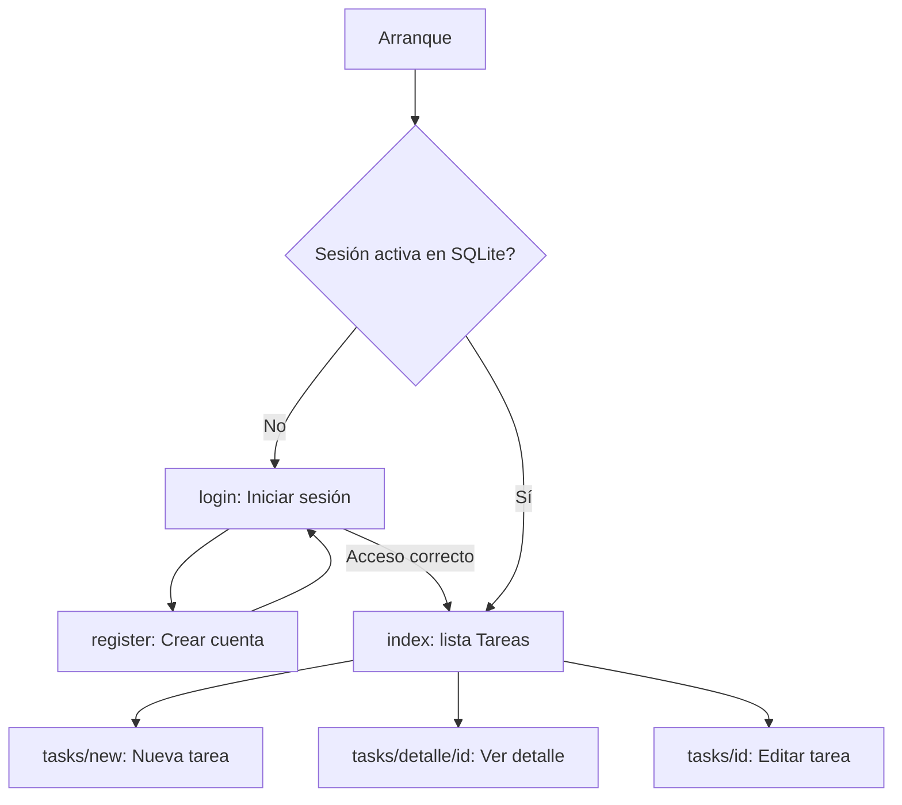
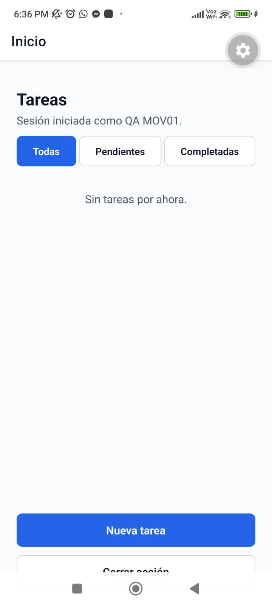
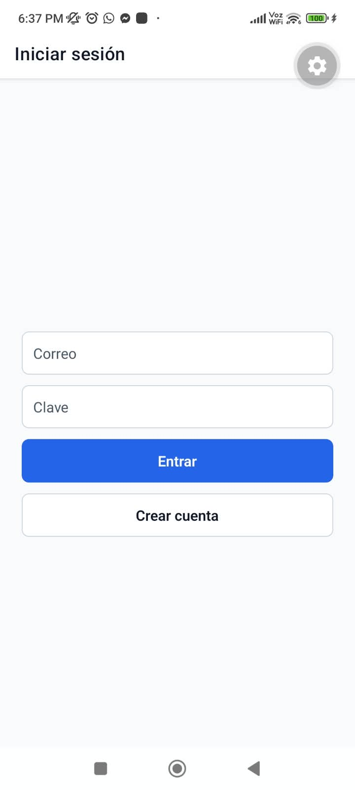
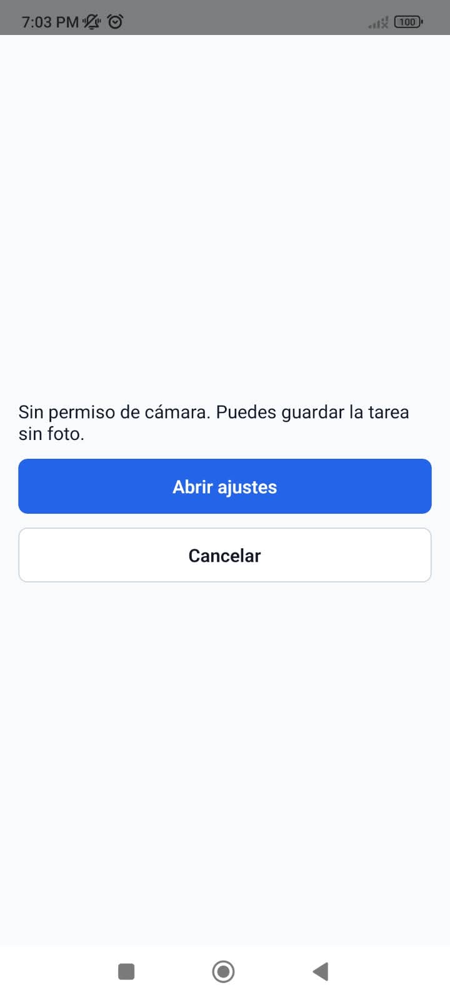
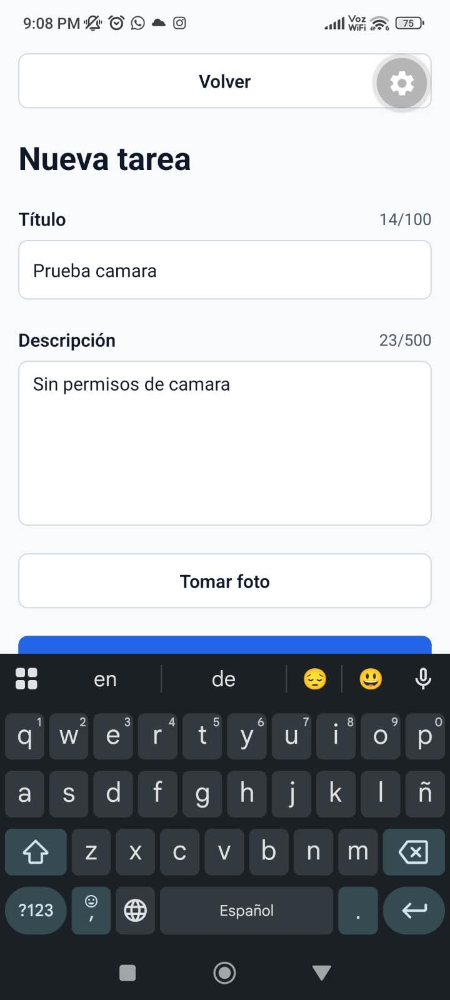
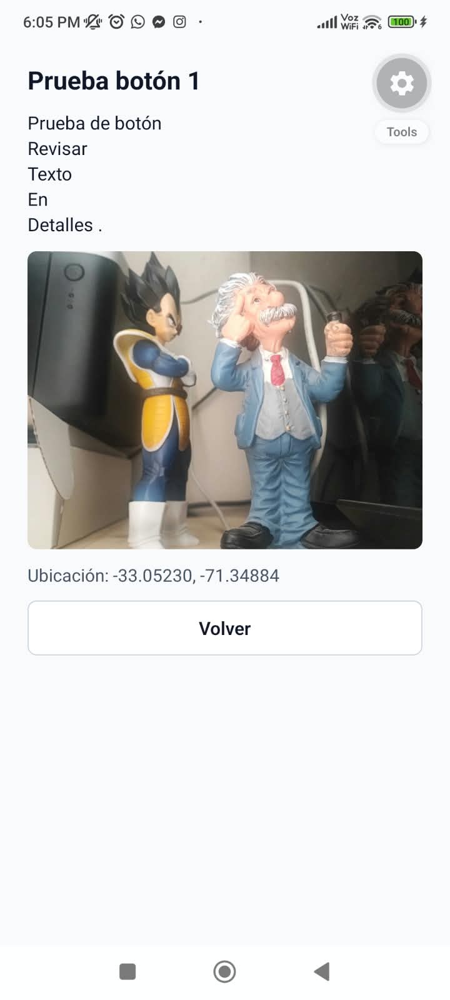
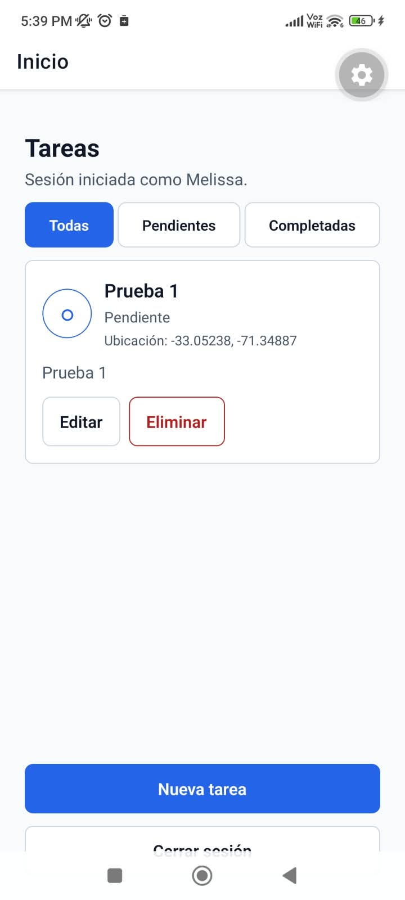
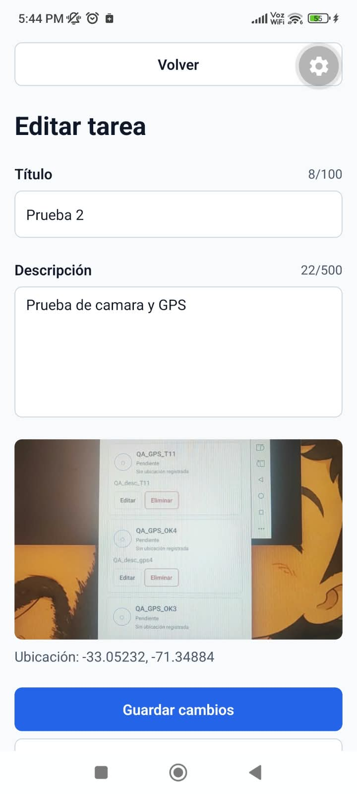
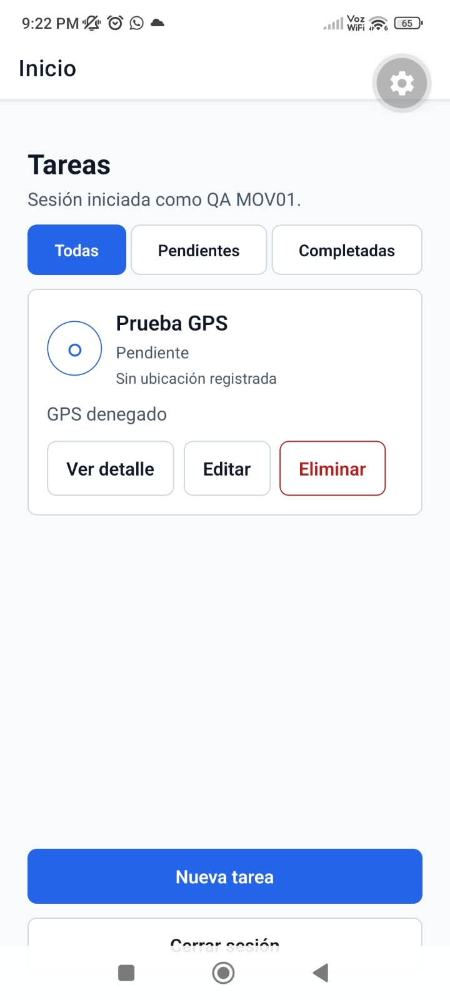
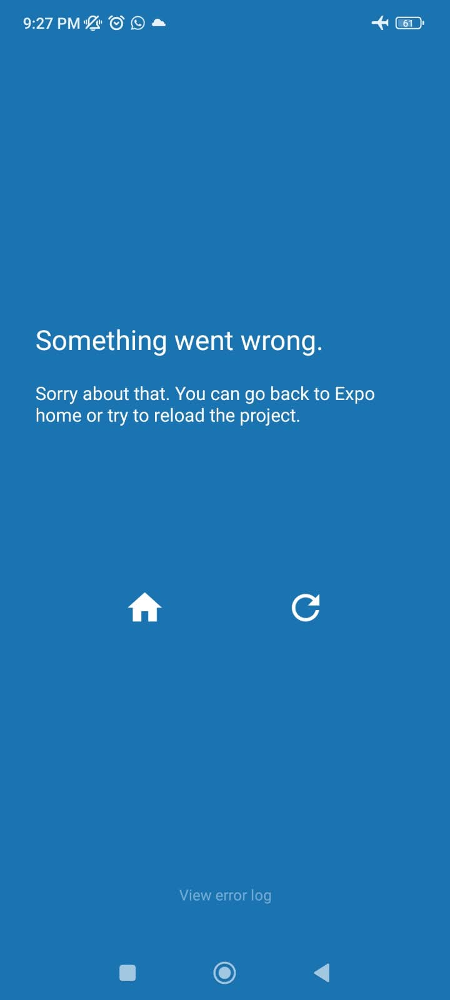

<div align="center">

**Instituto Profesional San Sebastián**


# To-Do móvil ampliada

**Informe de entrega EVA2: aplicación To-Do móvil ampliada con cámara, GPS y autenticación local**

**Asignatura:** Desarrollo de Aplicaciones Móviles, Unidad 2

**Integrantes:** Lukas Covarrubias y Sebastian Morales

**Profesor:** Boris Marcelo Belmar Muñoz

**Fecha:** 22 de noviembre de 2026

</div>

---

## Índice

1. [Introducción](#1-introducción)
2. [Objetivos y alcance](#2-objetivos-y-alcance)
3. [Requisitos y trazabilidad](#3-requisitos-y-trazabilidad)
4. [Estado de avance](#4-estado-de-avance)
5. [Arquitectura](#5-arquitectura)
6. [Decisiones técnicas](#6-decisiones-técnicas)
7. [Modelo de datos](#7-modelo-de-datos)
8. [Seguridad y permisos](#8-seguridad-y-permisos)
9. [Pruebas](#9-pruebas)
10. [Evidencias](#10-evidencias)
11. [Requisitos de ejecución](#11-requisitos-de-ejecución)
12. [Instalación y ejecución](#12-instalación-y-ejecución)
13. [Limitaciones, riesgos y defectos conocidos](#13-limitaciones-riesgos-y-defectos-conocidos)
14. [Control de versiones](#14-control-de-versiones)
15. [Documentación del proyecto](#15-documentación-del-proyecto)
16. [Entrega académica](#16-entrega-académica)

---

## 1. Introducción

La aplicación amplía la To-Do móvil de la Unidad 1. Cada usuario se registra en el dispositivo, inicia sesión y gestiona solo sus propias tareas. Al crear una tarea puede adjuntar una fotografía tomada con la cámara y registrar la ubicación GPS donde la creó.

Todo el almacenamiento es local: SQLite en el dispositivo, sin servidor, sin cuentas remotas y sin APIs externas. Esto permite usar la aplicación sin conexión (RF-13).

Funciones principales:

- Registro de cuenta y acceso con correo y clave; la clave se guarda como hash, nunca en claro.
- Lista de tareas filtrable por estado (Todas, Pendientes, Completadas).
- Crear, editar, eliminar (con confirmación), completar y reabrir tareas.
- Validación de campos con contadores y mensajes no bloqueantes.
- Foto adjunta por tarea, con miniatura en el detalle.
- Ubicación GPS de una única lectura al crear la tarea.

---

## 2. Objetivos y alcance

### 2.1. Objetivos

- Construir una aplicación móvil funcional que use dos periféricos del dispositivo (cámara y GPS).
- Proteger los datos de cada usuario mediante autenticación local.
- Probar la lógica de periféricos con pruebas automatizadas y verificar el comportamiento real en Android.

### 2.2. Incluido

- Autenticación local (RF-01 a RF-03).
- CRUD de tareas, filtros, validación y confirmación de eliminación (RF-04 a RF-10).
- Foto adjunta (RF-11) y ubicación GPS (RF-12).
- Persistencia sin conexión (RF-13).

### 2.3. Excluido

- Sincronización con servicio web o API externa, importación desde API y sincronización en tiempo real. Exención confirmada por escrito por el profesor (sección 16.3). Corresponde a RUB-04 y RUB-05.
- Seguimiento GPS continuo. Solo una lectura por tarea (`docs/02`, decisión 10).
- Varias fotos por tarea. Solo una (`docs/02`, decisión 9).

El alcance completo y su justificación están en [`docs/01`](./docs/01-REQUISITOS-RUBRICA.md) y [`docs/02`](./docs/02-DECISIONES-ARQUITECTURA.md).

---

## 3. Requisitos y trazabilidad

### 3.1. Requisitos funcionales

| ID    | Requisito                       | Criterio observable                                                               | Casos de prueba                                                            |
| ----- | ------------------------------- | --------------------------------------------------------------------------------- | -------------------------------------------------------------------------- |
| RF-01 | Registro de usuario             | Cuenta con nombre, correo y clave (mínimo 8 caracteres).                          | CP-AUTH-02, CP-MOV-01                                                      |
| RF-02 | Inicio de sesión                | Login con correo y clave; error genérico ante credenciales inválidas.             | CP-AUTH-01, CP-AUTH-03, CP-MOV-01                                          |
| RF-03 | Cierre de sesión                | Vuelve a la pantalla de acceso; no muestra tareas ajenas.                         | CP-MOV-01                                                                  |
| RF-04 | Listar tareas del usuario       | Solo tareas con `usuario_id` de la sesión activa.                                 | CP-TAR-01, CP-TAR-02                                                       |
| RF-05 | Crear tarea                     | Título y descripción obligatorios; se guarda en SQLite.                           | CP-TAR-01                                                                  |
| RF-06 | Editar tarea                    | Cambios persisten tras reinicio.                                                  | CP-MOV-06                                                                  |
| RF-07 | Eliminar tarea con confirmación | Diálogo de confirmación antes de borrar.                                          | Manual (sin caso propio)                                                   |
| RF-08 | Completar / reabrir tarea       | Cambia `completada`; persiste.                                                    | CP-MOV-06                                                                  |
| RF-09 | Filtrar tareas                  | Filtros Todas, Pendientes, Completadas.                                           | CP-TAR-02                                                                  |
| RF-10 | Validación de campos            | Límites de caracteres, recorte de espacios, contadores y mensajes no bloqueantes. | CP-TAR-01                                                                  |
| RF-11 | Foto adjunta a tarea            | Foto con cámara; se guarda `foto_uri`; se muestra en el detalle.                  | CP-PER-01, CP-PER-02, CP-MOV-02, CP-MOV-03                                 |
| RF-12 | Ubicación GPS al crear tarea    | Lectura única; se guardan `latitud` y `longitud`; se muestran en el detalle.      | CP-GPS-01, CP-GPS-02, CP-MOV-04, CP-MOV-05                                 |
| RF-13 | Persistencia sin conexión       | Tareas, usuarios y sesión sobreviven cierre y reapertura en modo avión.           | CP-MOV-06 (APROBADO por decisión del usuario con riesgo aceptado, CHK-047) |

Nota sobre "Manual (sin caso propio)": RF-07 se verifica en la navegación de la app, pero no tiene caso de prueba numerado en `docs/03`. Queda como pendiente de evidencia.

### 3.2. Requisitos no funcionales y de entrega

| Origen    | Requisito                                   | Tratamiento en el proyecto                                                          |
| --------- | ------------------------------------------- | ----------------------------------------------------------------------------------- |
| Enunciado | Captura de imagen con cámara                | `expo-camera` (RF-11)                                                               |
| Enunciado | GPS                                         | `expo-location` (RF-12)                                                             |
| Enunciado | Almacenamiento local sin conexión           | `expo-sqlite` (RF-13)                                                               |
| Enunciado | Autenticación que proteja las tareas        | Login local con hash; tareas filtradas por `usuario_id`                             |
| Enunciado | Pruebas automatizadas de cámara y ubicación | Jest + `jest-expo` (`src/features/camera`, `src/features/location`)                 |
| Enunciado | Ionic CLI y plugins de Capacitor            | **No aplicado.** El equipo aprobó React Native + Expo. Riesgo aceptado (sección 13) |
| Enunciado | Sincronización y APIs externas              | **No aplicado.** Exención confirmada por escrito por el profesor (sección 16.3)     |

---

## 4. Estado de avance

### 4.1. Requisitos

- RF-01 a RF-13 implementados en código.
- Detalle por requisito en la tabla de la sección 3.1.

### 4.2. Pruebas automatizadas

- Suite Jest: última ejecución completa registrada 7 suites y 22 pruebas aprobadas (CHK-022 en [`docs/04`](./docs/04-BITACORA.md)).
- Verificación de tipos (`tsc --noEmit`) y lint sin errores (CHK-034; repetido en CHK-036, 2026-11-22: `tsc` exit 0 y `eslint .` sin errores).

### 4.3. Pruebas en Android

Resultados de los casos manuales (detalle en [`docs/03`](./docs/03-PLAN-PRUEBAS.md), sección 2):

| Caso      | Requisito     | Estado                                                          | Evidencia principal                            | Comentario                                                                                                                                                                       |
| --------- | ------------- | --------------------------------------------------------------- | ---------------------------------------------- | -------------------------------------------------------------------------------------------------------------------------------------------------------------------------------- |
| CP-MOV-01 | RF-01 a RF-03 | APROBADO                                                        | `EV-13` (emulador), `EV-14` a `EV-17` (físico) | Registro, cierre y acceso repetido                                                                                                                                               |
| CP-MOV-02 | RF-11         | APROBADO                                                        | `EV-11`, `EV-12`                               | Miniatura visible en el detalle                                                                                                                                                  |
| CP-MOV-03 | RF-11, RUB-02 | APROBADO                                                        | `EV-18` a `EV-24`, `EV-20` (emulador)          | Cámara denegada: aviso no bloqueante                                                                                                                                             |
| CP-MOV-04 | RF-12         | APROBADO                                                        | `EV-08`, `EV-09`                               | Coordenadas visibles en tarjeta y detalle (teléfono físico)                                                                                                                      |
| CP-MOV-05 | RF-12, RUB-02 | APROBADO por decisión del usuario                               | `EV-26` a `EV-28`, `EV-31` a `EV-34`, `EV-41`  | Tarea sin coordenadas. Denegación de ubicación: `EV-41` ("No permitir", 9:05). Aviso no bloqueante no observado (sección 13)                                                     |
| CP-MOV-06 | RF-13         | APROBADO por decisión del usuario con riesgo aceptado (CHK-047) | `EV-30`, `EV-44`                               | Reabrir sin red en Expo Go de desarrollo falla (`Failed to download remote update`) por conexión con Metro; persistencia verificada con red (CHK-016). Build nativo no ejecutado |

Dispositivos de prueba:

- Teléfono físico: Xiaomi 11T Pro, modelo `2107113SG`, MIUI Global 14.0.2, Android 13 (build `TKQ1.220829.002`), parche de seguridad 2023-04-01 (`EV-10`, `EV-25`). Fuente principal de pruebas móviles.
- Emulador: `Medium_Phone_API_37.0` (sdk_gphone64_x86_64), Android 17 según `EV-20`. Usado para flujos sin GPS; no entrega posición a la app (decisión 17 de `docs/02`).

### 4.4. Gates académicos

| Gate                      | Criterio                                                        | Estado                                                                                                                                                               |
| ------------------------- | --------------------------------------------------------------- | -------------------------------------------------------------------------------------------------------------------------------------------------------------------- |
| G0 — Planificación        | Reglas, requisitos y decisiones aprobados por el usuario        | APROBADO (2026-11-21)                                                                                                                                                |
| G1 — Reproducibilidad     | `npm ci`, `expo install --check`, Jest, arranque con Expo       | PARCIAL: `prettier --check .` y `expo install --check` pasan (2026-11-22). Jest y arranque con Expo verificados en CHK previos. `npm ci` no ejecutado en esta sesión |
| G2 — Funciones esenciales | RF-01 a RF-13 y casos automatizados aprobados                   | APROBADO: RF-13 por decisión del usuario con riesgo aceptado (CHK-047); build nativo no ejecutado                                                                    |
| G3 — UX Android           | CP-MOV-01 a CP-MOV-06 con evidencia auténtica y revisión humana | Defecto aceptado al cortar red por conexión con Metro (`EV-30`, CHK-047)                                                                                             |
| G4 — Entrega              | Checklist de la sección 16 completo                             | PARCIAL: README como documento de entrega (decisión del usuario, 2026-11-22). Pendiente: formato Word/PDF (sección 16)                                               |

---

## 5. Arquitectura

### 5.1. Stack

| Capa         | Tecnología                  | Versión en `package.json`                                                     |
| ------------ | --------------------------- | ----------------------------------------------------------------------------- |
| Framework    | Expo SDK 58, React Native   | `expo ~58.0.26`, `react-native 0.88.1`, `react 19.3.0`                        |
| Lenguaje     | TypeScript en modo estricto | `typescript ~6.0.3`                                                           |
| Navegación   | Expo Router con Stack       | `expo-router ~58.0.32`                                                        |
| Persistencia | SQLite local                | `expo-sqlite ~58.0.18`                                                        |
| Cripto       | Hash SHA-256 y salt         | `expo-crypto ~58.0.8`                                                         |
| Cámara       | Captura de una foto         | `expo-camera ~58.0.14`                                                        |
| Archivos     | Copia permanente de la foto | `expo-file-system ~58.0.14`                                                   |
| Ubicación    | Lectura única GPS           | `expo-location ~58.0.22`                                                      |
| Pruebas      | Jest, `jest-expo`, RNTL     | `jest ~30.5.2`, `jest-expo ~58.0.15`, `@testing-library/react-native ^14.1.0` |
| Calidad      | ESLint, Prettier            | `eslint 9.39.5`, `prettier 3.9.10`                                            |

Las versiones se instalan con `npx expo install <paquete>` y se comprueban con `npx expo install --check` (`AGENTS.md`, sección 2).

### 5.2. Patrones

- **Estado:** Context + `useReducer` para sesión y tareas. `useState` local para formularios y filtros. Contadores y listas filtradas se derivan, sin estado duplicado.
- **Separación por capas en cada funcionalidad:** servicio (reglas), repositorio (SQLite), contexto (estado) y componentes (presentación).
- **Periféricos:** hooks y funciones puras con dependencias de Expo aisladas, para probarlas con mocks en Jest.

### 5.3. Mapa de rutas



| Ruta                  | Archivo                          | Función                                                      |
| --------------------- | -------------------------------- | ------------------------------------------------------------ |
| `/login`              | `src/app/login.tsx`              | Inicio de sesión                                             |
| `/register`           | `src/app/register.tsx`           | Registro de cuenta                                           |
| `/`                   | `src/app/index.tsx`              | Lista de tareas, filtros, cerrar sesión, botón "Nueva tarea" |
| `/tasks/new`          | `src/app/tasks/new.tsx`          | Alta de tarea con foto y GPS                                 |
| `/tasks/detalle/[id]` | `src/app/tasks/detalle/[id].tsx` | Vista de solo lectura (miniatura, coordenadas)               |
| `/tasks/[id]`         | `src/app/tasks/[id].tsx`         | Edición de tarea                                             |

Las rutas protegidas usan `Stack.Protected` según el estado de sesión (`src/app/_layout.tsx`). Las pantallas de acceso y las de tareas no pueden verse a la vez.

### 5.4. Estructura de carpetas

```
src/
  app/                    rutas Expo Router (sección 5.3)
  features/auth/          hash.ts, auth-service.ts, auth-repository.ts, auth-context.tsx
  features/tasks/         tasks-service.ts, tasks-repository.ts, tasks-context.tsx,
                          navigation.ts, model/task.ts, validation/validate-task.ts,
                          components/ (TaskCard, TaskForm)
  features/camera/        capturar-foto.ts, guardar-foto.ts, CameraCapture.tsx
  features/location/      ubicacion.ts (lectura GPS única)
  db/                     migrations.ts (apertura y migraciones de SQLite)
  components/             ActionButton.tsx (sin lógica de negocio)
  theme/tokens.ts         tokens de diseño
```

Los archivos de prueba `*.test.ts(x)` están junto al código que prueban. No hay capas adicionales: la estructura aprobada está en `docs/02`, sección 2.

### 5.5. Flujo de la foto y la ubicación

1. Al pulsar "Tomar foto", la app pide permiso de cámara (solo en ese momento).
2. Si se concede, `capturar-foto.ts` devuelve la URI temporal; `guardar-foto.ts` la copia al almacenamiento de la app.
3. Al guardar la tarea, `foto_uri` se guarda en SQLite. Si no hubo foto, queda `NULL`.
4. Para la ubicación, `ubicacion.ts` pide permiso y hace una única lectura con precisión `Balanced` (`docs/02`, decisión 10).
5. La lectura tiene un timeout de 10 segundos. Si no responde o falla, se devuelve `null` y la tarea se guarda sin coordenadas. No se usa la última posición conocida.
6. Si el permiso se deniega, la acción continúa sin el dato. El aviso no bloqueante no se observó en `EV-27` ni en `EV-32` (sección 13).

---

## 6. Decisiones técnicas

Las decisiones aprobadas están en [`docs/02`](./docs/02-DECISIONES-ARQUITECTURA.md), sección 1 (decisiones 1 a 17). Resumen:

| #   | Área             | Decisión                                                       | Motivo                                                         | Riesgo                                                                        |
| --- | ---------------- | -------------------------------------------------------------- | -------------------------------------------------------------- | ----------------------------------------------------------------------------- |
| 1   | Framework        | React Native + Expo + TypeScript estricto                      | Aprobado por el equipo                                         | Contradice el enunciado (Ionic + Capacitor)                                   |
| 7   | Autenticación    | Hash SHA-256 de `salt + clave`, salt de 16 bytes               | Sin servidor; clave no recuperable en claro                    | Hash simple frente a KDF (bcrypt, argon2); aceptado para el alcance académico |
| 8   | Permisos         | Solicitud al ejecutar la acción; denegado = continuar sin dato | Respeta la política de no pedir permisos al abrir la app       | Denegado permanente: botón "Abrir ajustes"                                    |
| 9   | Cámara           | `expo-camera`, una foto por tarea                              | Requisito RF-11                                                | Solo Expo Go como runtime                                                     |
| 10  | GPS              | `expo-location`, `Balanced`, lectura única                     | Requisito RF-12                                                | Sin seguimiento continuo                                                      |
| 11  | APIs             | Solo APIs internas del dispositivo                             | Exención confirmada por escrito por el profesor (sección 16.3) | RUB-04 y RUB-05 sin cubrir                                                    |
| 16  | Ejecución        | Expo Go + Metro; build nativo descartado                       | Ruta del proyecto supera MAX_PATH de Windows                   | Sin build de release verificado                                               |
| 17  | Verificación GPS | RF-12 se verifica en teléfono físico                           | Emulador no entrega posición a la app                          | Evidencia GPS depende de un dispositivo real                                  |

### 6.1. Comparación con el enunciado (Ionic + Capacitor)

El enunciado exige Ionic + Capacitor. El equipo eligió React Native + Expo. La comparación de [`docs/02`](./docs/02-DECISIONES-ARQUITECTURA.md), sección 4, no tiene ventajas medidas: cada celda queda como `NO VERIFICADO`. No se declara ninguna ventaja sin evidencia.

---

## 7. Modelo de datos

Definido en `docs/02`, sección 3. Implementado en `src/db/migrations.ts`.

```sql
usuarios(
  id INTEGER PRIMARY KEY,
  nombre TEXT NOT NULL,
  correo TEXT NOT NULL UNIQUE,
  clave_hash TEXT NOT NULL,
  salt TEXT NOT NULL,
  creado_en TEXT NOT NULL
)

tareas(
  id INTEGER PRIMARY KEY,
  usuario_id INTEGER NOT NULL REFERENCES usuarios(id),
  titulo TEXT NOT NULL,
  descripcion TEXT NOT NULL,
  completada INTEGER NOT NULL DEFAULT 0,
  latitud REAL,
  longitud REAL,
  foto_uri TEXT,
  creada_en TEXT NOT NULL
)

sesion(
  id INTEGER PRIMARY KEY CHECK (id = 1),
  usuario_id INTEGER NOT NULL REFERENCES usuarios(id)
)
```

- `sesion` tiene como máximo una fila. Sin fila = sin sesión.
- `latitud`, `longitud` y `foto_uri` son `NULL` cuando el permiso fue denegado o la función no se usó.
- Todas las consultas de tareas filtran por `usuario_id` de la sesión activa (RF-04).

---

## 8. Seguridad y permisos

### 8.1. Autenticación

- Clave con mínimo 8 caracteres (RF-01).
- Hash SHA-256 de `salt + clave` con `expo-crypto` (`digestStringAsync`). Salt de 16 bytes con `getRandomBytesAsync`, guardado en hexadecimal.
- Login con clave incorrecta: "Correo o clave incorrectos" (CP-AUTH-03). Mensaje genérico, no revela si el correo existe.
- Registro con correo existente: "Ya existe una cuenta con ese correo" (CP-AUTH-02). Este mensaje revela que el correo ya está registrado.

### 8.2. Autorización de datos

- Cada tarea pertenece a un `usuario_id`. Las consultas filtran por el usuario de la sesión.
- Cerrar sesión borra la fila de `sesion`; la lista deja de mostrar tareas.

### 8.3. Permisos del dispositivo

| Permiso   | Cuándo se pide            | Si se deniega                                                                  | Si se deniega permanentemente         |
| --------- | ------------------------- | ------------------------------------------------------------------------------ | ------------------------------------- |
| Cámara    | Al pulsar "Tomar foto"    | Aviso: "Sin permiso de cámara. Puedes guardar la tarea sin foto."              | Botón "Abrir ajustes"                 |
| Ubicación | Al crear la tarea con GPS | Tarea sin coordenadas; el aviso no bloqueante no se observó (`EV-27`, `EV-32`) | Botón "Abrir ajustes" (no verificado) |

Política (`docs/02`, sección 5):

1. Solicitar en la acción, nunca al arrancar la app.
2. Denegado: continuar sin el dato.
3. Denegado permanentemente: ofrecer "Abrir ajustes".
4. No almacenar coordenadas ni fotos fuera del dispositivo.

Las fotos se guardan en el almacenamiento de la app (`expo-file-system`). Las coordenadas se guardan en SQLite local.

---

## 9. Pruebas

### 9.1. Pruebas automatizadas (Jest + `jest-expo` + RNTL)

Ejecución: `npm test` (`jest --runInBand`). Mocks de `expo-camera`, `expo-location` y `expo-sqlite` solo en pruebas unitarias.

| Caso       | Unidad          | Criterio observable                                                                     | Requisito     |
| ---------- | --------------- | --------------------------------------------------------------------------------------- | ------------- |
| CP-PER-01  | Captura de foto | Permiso concedido y cámara que resuelve una URI: devuelve la URI                        | RF-11, RUB-03 |
| CP-PER-02  | Captura de foto | Permiso denegado: devuelve `null` sin lanzar excepción                                  | RF-11, RUB-02 |
| CP-GPS-01  | Ubicación       | Coordenadas `-33.45, -70.66` devueltas como `{ latitud, longitud }`                     | RF-12, RUB-03 |
| CP-GPS-02  | Ubicación       | Permiso denegado: devuelve `null` sin lanzar excepción                                  | RF-12, RUB-02 |
| CP-AUTH-01 | Hash de clave   | Mismo salt y clave: 64 caracteres hex, distintos de la clave, idénticos en dos llamadas | RF-01, RF-02  |
| CP-AUTH-02 | Registro        | Correo existente: "Ya existe una cuenta con ese correo"                                 | RF-01         |
| CP-AUTH-03 | Login           | Clave incorrecta: "Correo o clave incorrectos"                                          | RF-02         |
| CP-TAR-01  | Crear tarea     | Título vacío: error de validación y no inserta fila                                     | RF-05, RF-10  |
| CP-TAR-02  | Filtro          | "Completadas" devuelve solo tareas con `completada = 1`                                 | RF-09         |

Archivos de prueba existentes (7 suites):

- `src/features/auth/`: `hash.test.ts`, `auth-service.test.ts`.
- `src/features/tasks/`: `tasks-service.test.ts`, `validate-task.test.ts`, `TaskForm.test.tsx`.
- `src/features/camera/`: `capturar-foto.test.ts`.
- `src/features/location/`: `ubicacion.test.ts`.

Criterio de calidad: no se aceptan pruebas que solo comprueben texto del código, valores por defecto o que una función no lance excepción sin verificar su resultado (`docs/03`, sección 1).

### 9.2. Pruebas manuales en Android

Casos completos con pasos y resultados esperados en [`docs/03`](./docs/03-PLAN-PRUEBAS.md), sección 2. Resumen de pasos:

| Caso      | Pasos                                                     | Esperado                                                              |
| --------- | --------------------------------------------------------- | --------------------------------------------------------------------- |
| CP-MOV-01 | Registrar → cerrar sesión → iniciar sesión                | Lista vacía del usuario                                               |
| CP-MOV-02 | Crear tarea → tomar foto → guardar → abrir detalle        | Miniatura visible                                                     |
| CP-MOV-03 | Denegar cámara → tomar foto → guardar                     | Tarea sin foto; aviso no bloqueante                                   |
| CP-MOV-04 | Crear tarea con GPS permitido → abrir detalle             | Coordenadas visibles                                                  |
| CP-MOV-05 | Denegar GPS → crear tarea → abrir detalle                 | Tarea sin coordenadas; aviso no bloqueante (no observado, sección 13) |
| CP-MOV-06 | Modo avión → crear, editar y completar → cerrar y reabrir | Cambios persisten (ver sección 13)                                    |

### 9.3. Qué no prueban las pruebas automatizadas

- Los mocks de `expo-camera` y `expo-location` prueban la lógica, no el hardware.
- Las pruebas de red no aplican: no hay red que probar (`docs/02`, sección 6).
- Un caso que exige Android solo se aprueba con evidencia real (`AGENTS.md`, sección 8.1).

---

## 10. Evidencias

Evidencias en [`./docs/evidencias/capturas/`](./docs/evidencias/capturas/). Método de cada captura y revisión: `docs/03`, sección 4. Las capturas son copias originales, sin recortes ni reescalado salvo indicación.

| ID                                                                                                                    | Caso                     | Dispositivo | Qué muestra                                                                  | Resultado                                                         |
| --------------------------------------------------------------------------------------------------------------------- | ------------------------ | ----------- | ---------------------------------------------------------------------------- | ----------------------------------------------------------------- |
| [EV-01](./docs/evidencias/capturas/EV-01-expo-go-tareas-vacias.png)                                                   | Base                     | Emulador    | Pantalla Tareas vacía                                                        | Validada                                                          |
| [EV-02](./docs/evidencias/capturas/EV-02-expo-go-titulo-tareas.png)                                                   | Base                     | Emulador    | Cabecera "Inicio"                                                            | Validada                                                          |
| [EV-03](./docs/evidencias/capturas/EV-03-expo-go-clave-incorrecta.png)                                                | RF-02                    | Emulador    | "Correo o clave incorrectos"                                                 | Validada                                                          |
| [EV-04](./docs/evidencias/capturas/EV-04-expo-go-clave-corta.png)                                                     | RF-01                    | Emulador    | Clave de 3 caracteres rechazada                                              | Validada                                                          |
| [EV-05](./docs/evidencias/capturas/EV-05-expo-go-tareas-sin-flecha.png)                                               | RF-03                    | Emulador    | Tareas sin flecha de retroceso                                               | Validada                                                          |
| [EV-06](./docs/evidencias/capturas/EV-06-expo-go-sesion-tras-reabrir.png)                                             | RF-13                    | Emulador    | Sesión mantenida tras reabrir                                                | Validada                                                          |
| [EV-07](./docs/evidencias/capturas/EV-07-expo-go-registro-sin-flecha.png)                                             | RF-01                    | Emulador    | Registro sin flecha                                                          | Validada                                                          |
| [EV-08](./docs/evidencias/capturas/EV-08-telefono-fisico-tarjeta-ubicacion.jpeg)                                      | CP-MOV-04                | Físico      | Tarjeta con `Ubicación: -33.05238, -71.34887`                                | APROBADO                                                          |
| [EV-09](./docs/evidencias/capturas/EV-09-telefono-fisico-detalle-ubicacion.jpeg)                                      | CP-MOV-04                | Físico      | Detalle con ubicación                                                        | APROBADO                                                          |
| [EV-10](./docs/evidencias/capturas/EV-10-telefono-fisico-acerca-del-telefono.jpeg)                                    | Referencia               | Físico      | Acerca del teléfono                                                          | NO APLICA (dato)                                                  |
| [EV-11](./docs/evidencias/capturas/EV-11-telefono-fisico-detalle-miniatura.jpeg)                                      | CP-MOV-02                | Físico      | Miniatura de la foto en detalle                                              | APROBADO                                                          |
| [EV-12](./docs/evidencias/capturas/EV-12-telefono-fisico-lista-ver-detalle.jpeg)                                      | Soporte CP-MOV-02        | Físico      | Lista con "Ver detalle"                                                      | NO APLICA (soporte)                                               |
| [EV-13](./docs/evidencias/capturas/EV-13-emulador-cp-mov-01-login-lista-vacia.png)                                    | CP-MOV-01                | Emulador    | Login y lista vacía                                                          | APROBADO                                                          |
| [EV-14](./docs/evidencias/capturas/EV-14-telefono-fisico-cp-mov-01-registro-lista-vacia.jpeg)                         | CP-MOV-01                | Físico      | Registro con lista vacía                                                     | APROBADO                                                          |
| [EV-15](./docs/evidencias/capturas/EV-15-telefono-fisico-cp-mov-01-login-lista-vacia.png)                             | CP-MOV-01                | Físico      | Sesión iniciada                                                              | APROBADO                                                          |
| [EV-16](./docs/evidencias/capturas/EV-16-telefono-fisico-cp-mov-01-cierre-sesion.jpeg)                                | CP-MOV-01                | Físico      | Cierre de sesión                                                             | APROBADO                                                          |
| [EV-17](./docs/evidencias/capturas/EV-17-telefono-fisico-cp-mov-01-inicio-sesion-repetido.png)                        | CP-MOV-01                | Físico      | Inicio repetido con "QA MOV01"                                               | APROBADO                                                          |
| [EV-18](./docs/evidencias/capturas/EV-18-telefono-fisico-cp-mov-03-permiso-camara-denegado.jpeg)                      | CP-MOV-03                | Físico      | Cámara denegada, sin red                                                     | APROBADO                                                          |
| [EV-19](./docs/evidencias/capturas/EV-19-telefono-fisico-cp-mov-03-formulario-sin-foto.jpeg)                          | CP-MOV-03                | Físico      | Formulario sin foto                                                          | APROBADO por decisión del usuario                                 |
| [EV-20](./docs/evidencias/capturas/EV-20-emulador-cp-mov-03-permiso-camara-denegado.png)                              | CP-MOV-03                | Emulador    | Cámara denegada, modo avión                                                  | APROBADO por decisión del usuario                                 |
| [EV-21](./docs/evidencias/capturas/EV-21-telefono-fisico-cp-mov-03-inicio-sesion-qa-mov01.jpeg)                       | CP-MOV-03                | Físico      | Inicio con "QA MOV01"                                                        | APROBADO por decisión del usuario                                 |
| [EV-22](./docs/evidencias/capturas/EV-22-telefono-fisico-cp-mov-03-formulario-con-datos.jpeg)                         | CP-MOV-03                | Físico      | Formulario con datos                                                         | APROBADO por decisión del usuario                                 |
| [EV-23](./docs/evidencias/capturas/EV-23-telefono-fisico-cp-mov-03-permiso-camara-denegado-con-red.jpeg)              | CP-MOV-03                | Físico      | Aviso de cámara con red                                                      | APROBADO por decisión del usuario                                 |
| [EV-24](./docs/evidencias/capturas/EV-24-telefono-fisico-cp-mov-03-permiso-camara-denegado-modo-avion.jpeg)           | CP-MOV-03                | Físico      | Aviso de cámara en modo avión                                                | APROBADO por decisión del usuario                                 |
| [EV-25](./docs/evidencias/capturas/EV-25-telefono-fisico-info-dispositivo-modelo.png)                                 | Trazabilidad             | Físico      | Modelo `2107113SG`, Android 13                                               | APROBADO (dato)                                                   |
| [EV-26](./docs/evidencias/capturas/EV-26-telefono-fisico-cp-mov-05-lista-vacia.jpeg)                                  | CP-MOV-05                | Físico      | Lista vacía antes de la tarea                                                | APROBADO por decisión del usuario                                 |
| [EV-27](./docs/evidencias/capturas/EV-27-telefono-fisico-cp-mov-05-formulario-gps-denegado.jpeg)                      | CP-MOV-05                | Físico      | Formulario "GPS denegado"                                                    | APROBADO por decisión del usuario                                 |
| [EV-28](./docs/evidencias/capturas/EV-28-telefono-fisico-cp-mov-05-tarjeta-sin-ubicacion.jpeg)                        | CP-MOV-05                | Físico      | Tarjeta "Sin ubicación registrada"                                           | APROBADO por decisión del usuario                                 |
| [EV-29](./docs/evidencias/capturas/EV-29-telefono-fisico-cp-mov-05-tarjeta-modo-avion.jpeg)                           | Contexto CP-MOV-05       | Físico      | Tarjeta sin ubicación, modo avión                                            | NO APLICA como caso                                               |
| [EV-30](./docs/evidencias/capturas/EV-30-telefono-fisico-cp-mov-06-something-went-wrong-modo-avion.jpeg)              | CP-MOV-06                | Físico      | "Something went wrong" al abrir en modo avión                                | Defecto registrado (sección 13)                                   |
| [EV-31](./docs/evidencias/capturas/EV-31-telefono-fisico-cp-mov-05-permisos-expo-go.jpeg)                             | CP-MOV-05                | Físico      | Permisos de Expo Go sin concesiones                                          | APROBADO por decisión del usuario                                 |
| [EV-32](./docs/evidencias/capturas/EV-32-telefono-fisico-cp-mov-05-detalle-gps-denegado.jpeg)                         | CP-MOV-05                | Físico      | Detalle "GPS denegado", sin ubicación                                        | APROBADO por decisión del usuario                                 |
| [EV-33](./docs/evidencias/capturas/EV-33-telefono-fisico-cp-mov-05-permisos-expo-go-sin-permiso-0905.jpeg)            | CP-MOV-05                | Físico      | Permisos de Expo Go, sin permiso de ubicación (9:05)                         | APROBADO por decisión del usuario                                 |
| [EV-34](./docs/evidencias/capturas/EV-34-telefono-fisico-cp-mov-05-inicio-tarjeta-gps-denegado-0903.jpeg)             | CP-MOV-05                | Físico      | Inicio, tarjeta "Prueba GPS" con "GPS denegado" y "Sin ubicación registrada" | APROBADO por decisión del usuario                                 |
| [EV-35](./docs/evidencias/capturas/EV-35-telefono-fisico-cp-mov-05-detalle-flecha-inferior-0903.jpeg)                 | CP-MOV-05, flecha Volver | Físico      | Detalle con flecha debajo del contenido (defecto antes de la corrección)     | DEFECTO CORREGIDO; verificado en `EV-45`                          |
| [EV-45](./docs/evidencias/capturas/EV-45-telefono-fisico-cp-mov-05-detalle-flecha-arriba-0914.jpeg)                   | CP-MOV-05, flecha Volver | Físico      | Detalle con flecha arriba a la izquierda tras la corrección (9:14)           | APROBADO por decisión del usuario                                 |
| [EV-36](./docs/evidencias/capturas/EV-36-telefono-fisico-cp-mov-05-permisos-ubicacion-permanente-0905.jpeg)           | CP-MOV-05                | Físico      | Ubicación con permiso permanente (9:05); estado anterior a EV-41             | REEMPLAZADA por EV-41 (CHK-047)                                   |
| [EV-37](./docs/evidencias/capturas/EV-37-telefono-fisico-cp-mov-06-panel-modo-avion-0906.jpeg)                        | Contexto CP-MOV-06       | Físico      | Panel de ajustes rápidos con Modo avión resaltado                            | NO APLICA como caso                                               |
| [EV-38](./docs/evidencias/capturas/EV-38-telefono-fisico-cp-mov-05-inicio-tarjeta-gps-denegado-0903.jpeg)             | CP-MOV-05                | Físico      | Inicio, tarjeta "GPS denegado" (duplica EV-34)                               | APROBADO por decisión del usuario                                 |
| [EV-39](./docs/evidencias/capturas/EV-39-telefono-fisico-cp-mov-05-nueva-tarea-flecha-superior-0904.jpeg)             | CP-MOV-05, flecha Volver | Físico      | Nueva tarea con flecha arriba a la izquierda                                 | APROBADO por decisión del usuario                                 |
| [EV-40](./docs/evidencias/capturas/EV-40-telefono-fisico-cp-mov-06-expo-home-modo-avion-0906.jpeg)                    | Contexto CP-MOV-06       | Físico      | Inicio de Expo Go con modo avión; la app no carga                            | APROBADO por decisión del usuario                                 |
| [EV-41](./docs/evidencias/capturas/EV-41-telefono-fisico-cp-mov-05-permiso-ubicacion-no-permitir-0905.jpeg)           | CP-MOV-05                | Físico      | Permiso de ubicación "No permitir" (9:05); estado vigente                    | APROBADO por decisión del usuario (CHK-042); vigente (CHK-047)    |
| [EV-42](./docs/evidencias/capturas/EV-42-telefono-fisico-cp-mov-06-expo-home-sin-modo-avion-0903.jpeg)                | Referencia CP-MOV-06     | Físico      | Inicio de Expo Go sin modo avión                                             | NO APLICA como caso                                               |
| [EV-43](./docs/evidencias/capturas/EV-43-telefono-fisico-cp-mov-06-something-went-wrong-modo-avion-0906.jpeg)         | CP-MOV-06                | Físico      | "Something went wrong" con modo avión                                        | Defecto reproducido (sección 13)                                  |
| [EV-44](./docs/evidencias/capturas/EV-44-telefono-fisico-cp-mov-06-error-log-failed-download-remote-update-0906.jpeg) | CP-MOV-06                | Físico      | "View error log": `Failed to download remote update`                         | Causa documentada (sección 13); APROBADO por decisión del usuario |

Notas sobre evidencias:

- Las capturas de Android físico son copias recibidas por WhatsApp. Su hora y modelo están en la propia captura o en `EV-25`.
- Algunas capturas no muestran todos los pasos. Los pasos no capturados se indican en `docs/03` como `NO CAPTURADO` o `NO VERIFICADO`.
- EV-18 a EV-24 se revisaron por decisión del usuario con los datos declarados en `docs/03`.

---

## 11. Requisitos de ejecución

- Node.js y npm. Versiones del equipo de desarrollo: Node v24.19.0, npm 11.17.0.
- Expo Go para Android, instalado en el emulador o en el teléfono.
- Emulador Android: AVD `Medium_Phone_API_37.0`, o teléfono físico con depuración habilitada.
- Teléfono físico: en la misma red Wi-Fi que el equipo de desarrollo.
- Windows (equipo de desarrollo). El build nativo no se usa por el límite MAX_PATH de 260 caracteres (`docs/02`, decisión 16).

---

## 12. Instalación y ejecución

Ejecutar desde la raíz del repositorio.

### 12.1. Instalar dependencias

```bash
npm ci
```

Instala las versiones exactas de `package-lock.json`. Verificado: 1281 paquetes (CHK-022).

### 12.2. Iniciar la app

Emulador Android:

```bash
npx expo start --android
```

Teléfono físico:

```bash
npx expo start
```

Escanear el código QR con Expo Go.

Notas:

- No definir `CI=true` en el entorno: Metro desactiva la recarga en caliente.
- Si Metro muestra un bundle antiguo, reiniciar con caché limpia (`npx expo start -c`).

### 12.3. Comprobaciones

```bash
npm run typecheck
npm test
npm run lint
npm run format:check
```

| Comando                | Qué hace                                           | Última verificación            |
| ---------------------- | -------------------------------------------------- | ------------------------------ |
| `npm run typecheck`    | `tsc --noEmit`                                     | Sin errores (CHK-034)          |
| `npm test`             | Jest con `jest-expo`, en serie                     | 7 suites, 22 pruebas (CHK-022) |
| `npm run lint`         | ESLint                                             | Sin errores (CHK-034)          |
| `npm run format:check` | Prettier en `src/`, configuración y `package.json` | Pasa (CHK-034)                 |

Verificación de dependencias: `npx expo install --check` (CHK-003).

### 12.4. Prueba en Android

1. Abrir Expo Go en el emulador o el teléfono.
2. Registrar una cuenta (clave de 8 caracteres o más).
3. Crear una tarea con foto y ubicación. Conceder los permisos cuando se pidan.
4. Abrir "Ver detalle" para comprobar la foto y las coordenadas.
5. Repetir con los permisos denegados en Ajustes para comprobar los avisos no bloqueantes.

---

## 13. Limitaciones, riesgos y defectos conocidos

| Tipo             | Descripción                                                                                                                                 | Impacto                                                                     | Tratamiento                                                                                                                     |
| ---------------- | ------------------------------------------------------------------------------------------------------------------------------------------- | --------------------------------------------------------------------------- | ------------------------------------------------------------------------------------------------------------------------------- |
| Exención         | Sin APIs externas, sincronización ni importación (RUB-04 y RUB-05, 48 puntos)                                                               | Tope de 52/100 si la rúbrica no se recalcula (NO VERIFICADO)                | Confirmada por escrito por el profesor (sección 16.3): solo se evalúan APIs internas del dispositivo                            |
| Stack            | React Native + Expo en lugar de Ionic + Capacitor                                                                                           | Penalización posible por incumplir el enunciado                             | Aceptado; explicado en la sección 6.1 y en `docs/02`                                                                            |
| Defecto aceptado | "Something went wrong" en Expo Go al abrir la app en modo avión (`EV-30`, reproducido en CHK-030)                                           | CP-MOV-06 APROBADO por decisión del usuario con riesgo aceptado (CHK-047)   | Causa probable: conexión con Metro; Expo Go de desarrollo descarga el bundle (`EV-44`). No corregido; build nativo no ejecutado |
| Emulador         | No entrega posición a la app aunque `emu geo fix` responda OK (decisión 17)                                                                 | RF-12 solo se verifica en teléfono físico                                   | Aceptado por decisión del usuario                                                                                               |
| Latencia GPS     | Lectura única con timeout de 10 s; si vence, la tarea se guarda sin coordenadas                                                             | Coordenadas ausentes en lecturas lentas (una prueba en emulador tardó 13 s) | Decisión del equipo: sin fallback. Código en `src/features/location/ubicacion.ts`                                               |
| Expo Go          | Los módulos nativos se limitan a los incluidos en Expo Go del SDK 58                                                                        | Sin build de release propio                                                 | Aceptado; build nativo descartado (decisión 16)                                                                                 |
| Formato          | `prettier --check .` falla en 4 archivos: `assets/expo.icon/icon.json` (asset generado) y tres Markdown (`README.md`, `docs/03`, `docs/04`) | Afecta G1                                                                   | Pendiente de decisión del equipo                                                                                                |
| Aviso GPS        | Con ubicación denegada no se observó el aviso no bloqueante (`EV-27`, `EV-32`)                                                              | CP-MOV-05 aprobado por decisión del usuario sin ese aviso                   | Pendiente de decisión del equipo                                                                                                |
| Hash             | SHA-256 con salt, sin KDF dedicado                                                                                                          | Riesgo menor para el alcance académico                                      | Aceptado en `docs/02` decisión 7                                                                                                |

Los pendientes de decisión y bloqueos se registran en [`docs/04`](./docs/04-BITACORA.md).

---

## 14. Control de versiones

- Repositorio Git con remoto `origin` (GitHub) y rama `main`.
- Conventional Commits en español (`feat:`, `fix:`, `docs:`, `test:`, `chore:`).
- `push` a `origin/main` solo con autorización expresa del equipo; `merge` y operaciones destructivas en historial compartido no aplican (`AGENTS.md`, sección 6).
- Cada checkpoint de avance se registra en [`docs/04`](./docs/04-BITACORA.md) con su commit real.

---

## 15. Documentación del proyecto

| Documento                                                                  | Contenido                                                                           |
| -------------------------------------------------------------------------- | ----------------------------------------------------------------------------------- |
| [AGENTS.md](./AGENTS.md)                                                   | Reglas de gobernanza para agentes de desarrollo: autonomía, Git, gates, Context7    |
| [docs/01-REQUISITOS-RUBRICA.md](./docs/01-REQUISITOS-RUBRICA.md)           | Requisitos del enunciado, RF, puntajes de la rúbrica, riesgos, checklist de entrega |
| [docs/02-DECISIONES-ARQUITECTURA.md](./docs/02-DECISIONES-ARQUITECTURA.md) | Decisiones 1 a 17, estructura, modelo de datos, comparación con Capacitor, permisos |
| [docs/03-PLAN-PRUEBAS.md](./docs/03-PLAN-PRUEBAS.md)                       | Casos automatizados y manuales, gates académicos, catálogo de evidencias            |
| [docs/04-BITACORA.md](./docs/04-BITACORA.md)                               | Checkpoints `CHK-###` con fecha, commit, verificación y bloqueos                    |
| [docs/evidencias/capturas/](./docs/evidencias/capturas/)                   | Capturas `EV-##`                                                                    |

---

## 16. Entrega académica

### 16.1. Documento de entrega

- Documento de entrega: este `README.md`, en Markdown. Decisión del usuario (2026-11-22): no se genera un documento Word o PDF aparte; este README cubre los ítems temáticos, el detalle de decisiones de stack y las evidencias.
- Riesgo: el enunciado exige Word o PDF. Si el docente lo exige, el archivo `EVA2_APLICACIONES_MOVILES_LUKAS_COVARRUBIAS_SEBASTIAN_MORALES` aún no existe. El nombre sigue la decisión de CHK-002, que difiere de `EVU2_APELLIDO_NOMBRE`. Penalización posible.
- Profesor: Boris Marcelo Belmar Muñoz (ver sección 16.3). Logo institucional: `./docs/assets/logo-instituto-profesional-san-sebastian.png`.

### 16.2. Checklist (formato del enunciado)

| Ítem del enunciado                                          | Estado      | Nota                                                                  |
| ----------------------------------------------------------- | ----------- | --------------------------------------------------------------------- |
| Portada: título, asignatura, integrantes                    | CUMPLIDO    | Encabezado de este README (Lukas Covarrubias y Sebastian Morales)     |
| Portada: profesor                                           | CUMPLIDO    | Boris Marcelo Belmar Muñoz, según el chat del docente (16.3)          |
| Portada: logo institucional                                 | CUMPLIDO    | Logo del Instituto Profesional San Sebastián en el encabezado         |
| Desarrollo de los ítems temáticos                           | CUMPLIDO    | Secciones 1 a 15                                                      |
| Archivo Word o PDF                                          | NO CUMPLIDO | Decisión del usuario; riesgo en 16.1                                  |
| Nombre de archivo                                           | NO CUMPLIDO | Solo aplica a Word o PDF; ver 16.1                                    |
| Arial 12, interlineado 1,15, justificado, páginas numeradas | NO CUMPLIDO | Formato de Word o PDF; el README es Markdown                          |
| Evidencias de `docs/evidencias/` referenciadas              | CUMPLIDO    | EV-01 a EV-45 en sección 10; enlaces relativos resueltos (2026-11-22) |
| Pantallazos en el informe                                   | CUMPLIDO    | Sección 16.4 (capturas embebidas) y sección 10 (EV-01 a EV-45)        |
| Exención de APIs                                            | CUMPLIDO    | Confirmada por escrito por el profesor (16.3)                         |
| Riesgo de stack explicado                                   | CUMPLIDO    | Sección 6.1 y `docs/02`, sección 4                                    |

Estado de los gates de entrega: G4 `PARCIAL` (sección 4.4). Pendiente del equipo: formato Word/PDF.

### 16.3. Confirmación escrita del profesor (APIs)

Texto del chat de la asignatura, transcrito de la captura del docente (`Boris Marcelo Belmar Muñoz`, miércoles 18 de noviembre de 2026, 8:50 PM; fecha confirmada por el equipo):

> Hola a todos muchachos,
>
> Esto lo mencioné en clases pero lo voy a dejar por escrito:
>
> - Solo se va a evaluar la conexión con API interna del dispositivo, no la conexión con APIs externas (Servicios web). Para que no consideren lo de los servicios web.
> - Es el mismo proyecto, puede ser el mismo repo.
> - Da igual el nombre del repo.
> - El informe puede ser el mismo README.md. Incluyan pantallazos.

Consecuencias para este documento:

- Exención de APIs externas confirmada por escrito. Sin RUB-04 y RUB-05 en la evaluación; el puntaje según la rúbrica queda NO VERIFICADO (el docente no indicó recálculo).
- Este README es el informe. El nombre del repositorio no es requisito.
- Pantallazos: sección 16.4.
- Captura original del chat: no versionada en el repositorio.

### 16.4. Pantallazos del informe

Capturas reales de la app en Xiaomi 11T Pro (Android 13, Expo Go). Lista completa en la sección 10.

**EV-14** · CP-MOV-01 · registro con lista vacía


**EV-15** · CP-MOV-01 · sesión iniciada



**EV-16** · CP-MOV-01 · cierre de sesión



**EV-18** · CP-MOV-03 · cámara denegada, sin red



**EV-22** · CP-MOV-03 · formulario con datos



**EV-11** · CP-MOV-02 · miniatura de la foto en detalle



**EV-08** · CP-MOV-04 · tarjeta con ubicación



**EV-09** · CP-MOV-04 · detalle con ubicación



**EV-28** · CP-MOV-05 · tarjeta sin ubicación (GPS denegado)



**EV-30** · CP-MOV-06 · defecto "Something went wrong" al abrir en modo avión (no resuelto)


