# 03 — Plan de pruebas y gates académicos

> **Estado:** CP-PER-01/02 y CP-GPS-01/02 con pruebas unitarias OK (`npx jest src/features/camera src/features/location`, 2026-11-21). Teléfono Android físico (2026-11-21, Xiaomi 11T Pro, fuente principal de pruebas móviles por limitaciones del emulador): CP-MOV-01 APROBADO con la secuencia registro (`EV-14`, 6:29 PM) → sesión iniciada (`EV-15`, 6:36 PM) → cierre de sesión (`EV-16`, 6:37 PM) → inicio repetido con "QA MOV01" (`EV-17`, 6:41 PM); CHK-021. CP-MOV-02 APROBADO con `EV-11` (miniatura visible en detalle, CHK-015); CP-MOV-03 APROBADO por decisión del usuario con `EV-18` y `EV-19` (cámara denegada, 7:03 PM, sin red; paso de guardado sin captura; CHK-023); CP-MOV-04 APROBADO con `EV-08` y `EV-09` (CHK-014). Defecto abierto: "Something went wrong" reportado al cortar red (captura de 6:53 PM); no reproducido en emulador (CHK-023); reproducido en Android físico con modo avión (`EV-30`, CHK-030). Emulador (2026-11-21, CHK-016): CP-MOV-01 OK con `EV-13` (aprobada por el usuario, CHK-020); CP-MOV-06 APROBADO con desviación (persistencia verificada tras reinicio con red; reapertura sin red no alcanzable con Expo Go en desarrollo). Emulador (CHK-009): CP-MOV-03 y CP-MOV-05 OK. CP-MOV-04 en emulador FALLO (el emulador no entrega posición a la app, CHK-012).
> **Referencias:** requisitos en [`docs/01`](./01-REQUISITOS-RUBRICA.md); gates de calidad por tarea en [`AGENTS.md`](../AGENTS.md) sección 8.

## 1. Pruebas automatizadas (Jest + `jest-expo` + RNTL)

Mocks de `expo-camera`, `expo-location` y `expo-sqlite` permitidos solo en pruebas unitarias.

| ID         | Unidad               | Criterio observable                                                                                                    | Requisito     |
| ---------- | -------------------- | ---------------------------------------------------------------------------------------------------------------------- | ------------- |
| CP-PER-01  | `usePhotoCapture`    | Con permiso concedido y cámara que resuelve `{ uri: "file:///x.jpg" }`, devuelve `"file:///x.jpg"`.                    | RF-11, RUB-03 |
| CP-PER-02  | `usePhotoCapture`    | Con permiso denegado, devuelve `null` sin lanzar excepción.                                                            | RF-11, RUB-02 |
| CP-GPS-01  | `useCurrentLocation` | Con mock de coordenadas `-33.45, -70.66`, devuelve `{ latitud: -33.45, longitud: -70.66 }`.                            | RF-12, RUB-03 |
| CP-GPS-02  | `useCurrentLocation` | Con permiso denegado, devuelve `null` sin lanzar excepción.                                                            | RF-12, RUB-02 |
| CP-AUTH-01 | `hashClave`          | Con el mismo salt y clave `"clave1234"`, devuelve 64 caracteres hex, distintos de la clave, idénticos en dos llamadas. | RF-01, RF-02  |
| CP-AUTH-02 | Registro             | Correo existente devuelve `"Ya existe una cuenta con ese correo"`.                                                     | RF-01         |
| CP-AUTH-03 | Login                | Clave incorrecta devuelve `"Correo o clave incorrectos"`.                                                              | RF-02         |
| CP-TAR-01  | Crear tarea          | Título vacío devuelve error de validación y no inserta fila.                                                           | RF-05, RF-10  |
| CP-TAR-02  | Filtro               | Filtro "Completadas" devuelve solo tareas con `completada = 1`.                                                        | RF-09         |

Criterio: no escribir pruebas que solo comprueben texto del código, valores por defecto o que la función no lance excepción sin verificar su resultado.

## 2. Pruebas manuales en Android (GA-4)

Requieren emulador o dispositivo Android real con Expo Go (modalidad aprobada, `docs/02` decisión 16). Cada caso con captura antes/después cuando la operación lo exige.

| ID        | Pasos                                                                               | Esperado                                                                                                           | Requisito     |
| --------- | ----------------------------------------------------------------------------------- | ------------------------------------------------------------------------------------------------------------------ | ------------- |
| CP-MOV-01 | Registrar cuenta → cerrar sesión → iniciar sesión con las mismas credenciales.      | Acceso a la lista de tareas vacía del usuario.                                                                     | RF-01 a RF-03 |
| CP-MOV-02 | Crear tarea → tomar foto desde el formulario → guardar → abrir detalle.             | Miniatura visible en el detalle.                                                                                   | RF-11         |
| CP-MOV-03 | Denegar permiso de cámara → intentar tomar foto → guardar.                          | Tarea creada sin foto; mensaje no bloqueante.                                                                      | RF-11, RUB-02 |
| CP-MOV-04 | Crear tarea con GPS permitido → abrir detalle.                                      | Coordenadas visibles.                                                                                              | RF-12         |
| CP-MOV-05 | Denegar GPS → crear tarea → abrir detalle.                                          | Tarea sin coordenadas; mensaje no bloqueante.                                                                      | RF-12, RUB-02 |
| CP-MOV-06 | Activar modo avión → crear, editar y completar una tarea → cerrar y reabrir la app. | Cambios persisten. Criterio aprobado 2026-11-21: reapertura verificada con red tras los cambios offline (CHK-016). | RF-13         |

## 3. Gates académicos

| Gate                      | Criterio                                                                                                                          | Estado                                                                                                                                                                                                                                                                                               |
| ------------------------- | --------------------------------------------------------------------------------------------------------------------------------- | ---------------------------------------------------------------------------------------------------------------------------------------------------------------------------------------------------------------------------------------------------------------------------------------------------- |
| G0 — Planificación        | Reglas, requisitos y decisiones documentados y aprobados por el usuario.                                                          | APROBADO (2026-11-21)                                                                                                                                                                                                                                                                                |
| G1 — Reproducibilidad     | `npm ci`, `npx expo install --check`, `npx jest`, `npx expo start` ejecutados con resultados reales.                              | PARCIAL: `npm ci` limpio OK (1281 paquetes, CHK-022); `tsc --noEmit`, `npm run lint` y `npx jest` (7 suites, 22/22) OK (CHK-022); `expo install --check` y `expo start` OK (CHK-003, CHK-004). `prettier --check .` falla solo en `assets/expo.icon/icon.json` (asset generado; decisión pendiente). |
| G2 — Funciones esenciales | RF-01 a RF-13 implementados y CP-AUTH, CP-TAR, CP-PER, CP-GPS aprobados.                                                          | PARCIAL: CP-AUTH-01 a 03, CP-TAR-01/02, CP-PER-01/02 y CP-GPS-01/02 APROBADOS por Jest (22/22, CHK-022). RF-13 con desviación aceptada por el usuario en CP-MOV-06 (CHK-016).                                                                                                                        |
| G3 — UX Android           | CP-MOV-01 a CP-MOV-06 con evidencia auténtica y revisión humana.                                                                  | PARCIAL: CP-MOV-01 (físico `EV-14` a `EV-17` APROBADO; emulador `EV-13` aprobada), CP-MOV-02 (`EV-11`), CP-MOV-03 (`EV-18`, `EV-19`, aprobado por decisión del usuario; CHK-023), CP-MOV-04 (`EV-08`, `EV-09`), CP-MOV-05 y CP-MOV-06 (desviación, CHK-016) OK. Defecto abierto: cierre de app al cortar red; reproducido en físico con modo avión (`EV-30`, CHK-030).                     |
| G4 — Entrega              | Checklist de `docs/01` sección 6 completo; PDF o Word con nombre `EVA2_APLICACIONES_MOVILES_LUKAS_COVARRUBIAS_SEBASTIAN_MORALES`. | NO EJECUTADO                                                                                                                                                                                                                                                                                         |

Cierre de entrega: todos los casos en `APROBADO` o en `NO EJECUTADO`/`BLOQUEADO` con motivo escrito.

## 4. Evidencias

- Ruta: `./docs/evidencias/capturas/` desde la raíz (`./evidencias/capturas/` desde `docs/`).
- `EV-01` (agente; emulador `Medium_Phone_API_37.0`; Expo Go; commit `a2e5b8f`): pantalla "Tareas / Sin tareas por ahora.". Revisión humana pendiente.
- `EV-08` — CP-MOV-04, RF-12. Método: agente con captura del usuario. Fecha: 2026-11-21; hora de captura NO VERIFICADA (archivo WhatsApp recibido 5.41.28 PM). Dispositivo: Xiaomi 11T Pro, MIUI Global 14.0.2, Android 13 (TKQ1.220829.002), parche 2023-04-01 (ver `EV-10`). Modalidad: Expo Go (última estable de Play Store, confirmado por el usuario; versión exacta NO VERIFICADA) + Metro local. Commit: `66fd218`. Pasos: crear "Prueba 1" con GPS permitido, guardar, ver tarjeta. Esperado: `Ubicación: lat, lon`. Observado: `Ubicación: -33.05238, -71.34887`. Copia recibida por WhatsApp, sin recorte ni reescalado. Revisor: usuario del equipo (revisión visual 2026-11-21). Resultado: APROBADO.
  
- `EV-09` — CP-MOV-04, RF-12. Método: agente con captura del usuario. Fecha: 2026-11-21; hora de captura NO VERIFICADA (archivo WhatsApp recibido 5.44.09 PM). Dispositivo: Xiaomi 11T Pro, MIUI Global 14.0.2, Android 13 (ver `EV-10`). Modalidad: Expo Go (última estable de Play Store, confirmado por el usuario; versión exacta NO VERIFICADA) + Metro local. Commit: `66fd218`. Pasos: abrir "Prueba 2" en Editar tarea y ver la línea Ubicación. Esperado: `Ubicación: lat, lon`. Observado: `Ubicación: -33.05232, -71.34884`. Copia recibida por WhatsApp, sin recorte ni reescalado. Revisor: usuario del equipo (revisión visual 2026-11-21). Resultado: APROBADO.
  
- `EV-10` — Referencia de dispositivo, no prueba funcional. Método: agente con captura del usuario. Fecha: 2026-11-21, 5:47 PM (visible en la captura). Muestra: Xiaomi 11T Pro, MIUI Global 14.0.2, Android 13 (TKQ1.220829.002), parche de seguridad 2023-04-01. Revisor: usuario del equipo. Resultado: NO APLICA (dato de dispositivo).
  
- `EV-11` — CP-MOV-02, RF-11. Método: agente con captura del usuario. Fecha: 2026-11-21, 6:05 PM (visible en la captura). Dispositivo: Xiaomi 11T Pro, MIUI Global 14.0.2, Android 13 (ver `EV-10`). Modalidad: Expo Go (versión NO VERIFICADA) + Metro LAN (`exp://192.168.1.81:8081`). Código: working tree sobre `2beb98a` con cambios de detalle sin commit (CHK-015). Pasos: abrir "Ver detalle" de una tarea con foto. Esperado: miniatura visible en el detalle. Observado: fotografía visible (no negra), título "Prueba botón 1", `Ubicación: -33.05230, -71.34884`. Copia recibida por WhatsApp, sin recorte ni reescalado. Revisor: usuario del equipo. Resultado: APROBADO.
  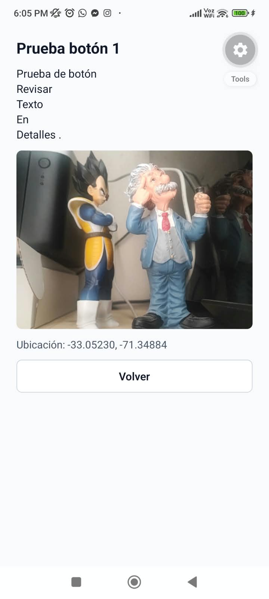
- `EV-12` — soporte de navegación para CP-MOV-02 (no es caso propio). Método: agente con captura del usuario. Fecha: 2026-11-21, 6:05 PM (visible en la captura). Dispositivo: ver `EV-11`. Observado: lista con botón "Ver detalle" en "Prueba botón 1" y "Prueba 2". Revisor: usuario del equipo. Resultado: NO APLICA como caso; respalda `EV-11`.
  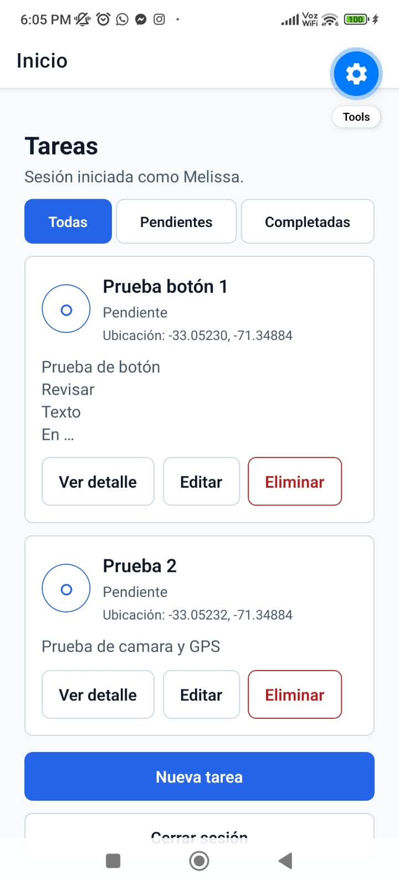
- `EV-18` — CP-MOV-03, RF-11, RUB-02. Método: agente con captura del usuario (copia WhatsApp 7:04.44 PM, sin recorte ni reescalado). Fecha: 2026-11-21, 7:03 PM (visible en la captura). Dispositivo: Xiaomi 11T Pro, Android 13 (ver `EV-10`; modelo NO VERIFICADO en esta captura). Modalidad: Expo Go + Metro LAN (`exp://192.168.1.81:8081`). Commit: `643af66`. Pasos: denegar permiso de cámara, sin red, tocar "Tomar foto". Esperado: aviso no bloqueante con opción de guardar sin foto. Observado: "Sin permiso de cámara. Puedes guardar la tarea sin foto." con `Abrir ajustes` y `Cancelar`; barra de estado sin Wi-Fi ni señal. Revisor: usuario del equipo. Resultado: APROBADO.
  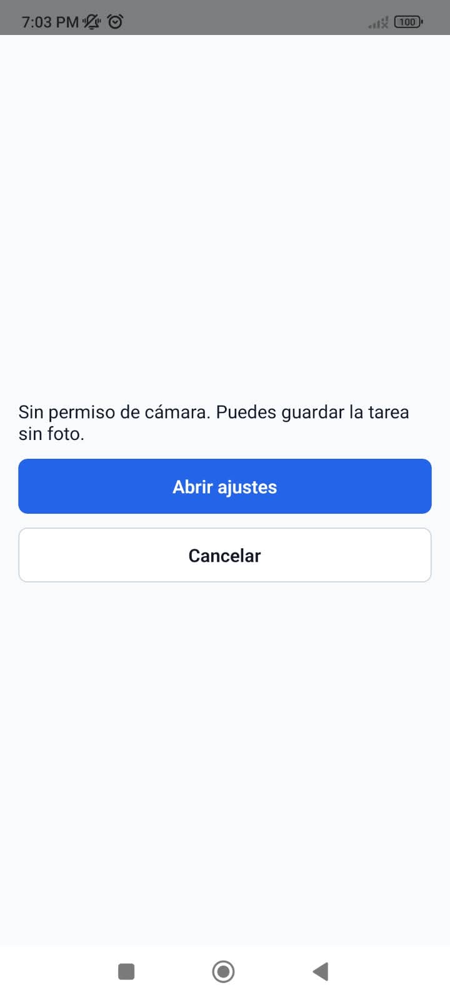
- `EV-19` — CP-MOV-03, RF-11. Método: agente con captura del usuario (copia WhatsApp 7:04.44 PM (1), sin recorte ni reescalado). Fecha: 2026-11-21, 7:03 PM (visible en la captura). Dispositivo: ver `EV-18`. Modalidad: ver `EV-18`. Commit: `643af66`. Observado: formulario "Nueva tarea" vacío con `Tomar foto`, `Guardar tarea` y `Cancelar`; barra de estado sin Wi-Fi ni señal; botón flotante de desarrollo de Expo visible. Orden respecto a `EV-18`: NO VERIFICADO. Paso "guardar sin foto": NO CAPTURADO. Revisor: usuario del equipo. Resultado: APROBADO por decisión del usuario (ver CHK-023).
  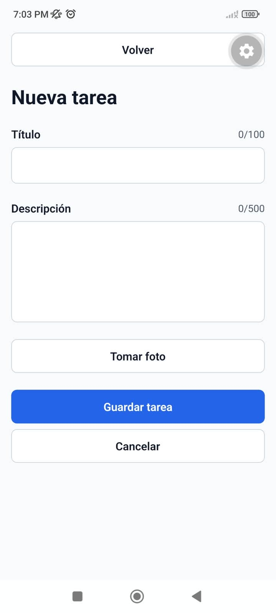
- `EV-20` — CP-MOV-03, RF-11. Método: agente, captura del emulador (`adb exec-out screencap`). Fecha: 2026-11-21, 7:09 PM (hora del emulador). Dispositivo: emulador `Medium_Phone_API_37.0` (`sdk_gphone64_x86_64`), Android 17. Modalidad: Expo Go + Metro (`adb reverse tcp:8081`). Código: HEAD `f8ae7bf`. Pasos: app abierta con red en "Nueva tarea"; `CAMERA granted=false` (`pm revoke`); modo avión activo (`airplane_mode_on=1`); tocar "Tomar foto". Esperado: aviso no bloqueante con `Abrir ajustes`, `Cancelar`. Observado: "Sin permiso de cámara. Puedes guardar la tarea sin foto." con `Abrir ajustes` y `Cancelar`; texto idéntico a `EV-18`. Revisor: usuario del equipo. Resultado: APROBADO por decisión del usuario (CHK-026).
  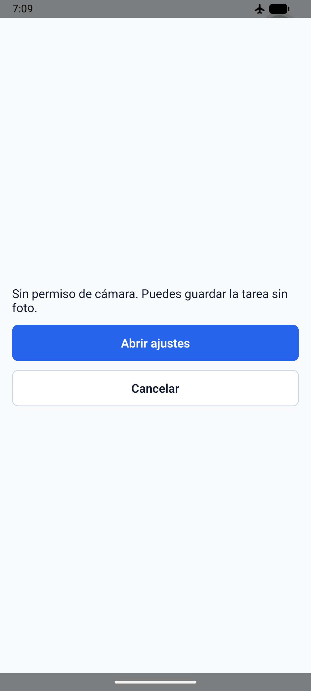
- `EV-21` — CP-MOV-03, RF-11. Método: usuario del equipo, copia WhatsApp `9.10.17 PM (1)`, sin recorte ni reescalado. Fecha: 2026-11-21, 9:08 PM (visible en la barra de estado). Dispositivo: Xiaomi 11T Pro (ver `EV-10`), modelo `2107113SG` (ver `EV-25`). Android: 13 (ver `EV-25`). Modalidad: NO VERIFICADO. Commit: `e83c513`. Observado: pantalla "Inicio" con sesión "QA MOV01", "Sin tareas por ahora.", filtros `Todas`/`Pendientes`/`Completadas`, `Nueva tarea` y `Cerrar sesión`; Wi-Fi y señal visibles. Pasos previos: NO VERIFICADO. Revisor: usuario del equipo. Resultado: APROBADO por decisión del usuario (CHK-026).
  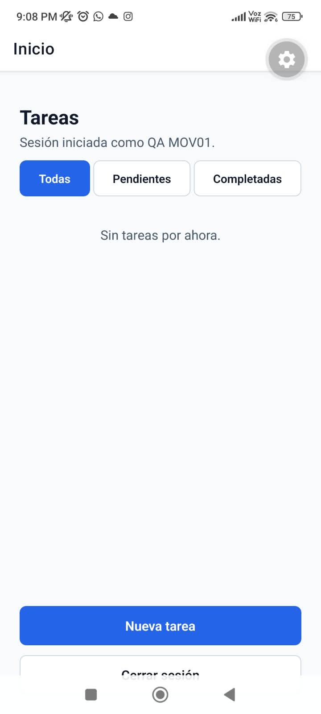
- `EV-22` — CP-MOV-03, RF-11. Método: usuario del equipo, copia WhatsApp `9.10.17 PM (2)`, sin recorte ni reescalado. Fecha: 2026-11-21, 9:08 PM. Dispositivo: Xiaomi 11T Pro (ver `EV-10`), modelo `2107113SG` (ver `EV-25`). Android: 13 (ver `EV-25`). Modalidad: NO VERIFICADO. Commit: `e83c513`. Observado: "Nueva tarea" con título "Prueba camara" (contador `14/100`) y descripción "Sin permisos de camara" (contador `23/500`), botón `Tomar foto` y teclado abierto; Wi-Fi y señal visibles. Los contadores no coinciden con la longitud visible del texto (13 y 22 caracteres); causa NO VERIFICADA. Captura previa a tocar `Tomar foto`: no muestra el aviso. Revisor: usuario del equipo. Resultado: APROBADO por decisión del usuario (CHK-026).
  
- `EV-23` — CP-MOV-03, RF-11. Método: usuario del equipo, copia WhatsApp `9.10.17 PM`, sin recorte ni reescalado. Fecha: 2026-11-21, 9:08 PM. Dispositivo: Xiaomi 11T Pro (ver `EV-10`), modelo `2107113SG` (ver `EV-25`). Android: 13 (ver `EV-25`). Modalidad: NO VERIFICADO. Commit: `e83c513`. Observado: aviso "Sin permiso de cámara. Puedes guardar la tarea sin foto." con `Abrir ajustes` y `Cancelar`; Wi-Fi y señal visibles (con red). Pasos (permiso denegado, tocar `Tomar foto`): NO VERIFICADO; el toque no aparece en la captura. Revisor: usuario del equipo. Resultado: APROBADO por decisión del usuario (CHK-026).
  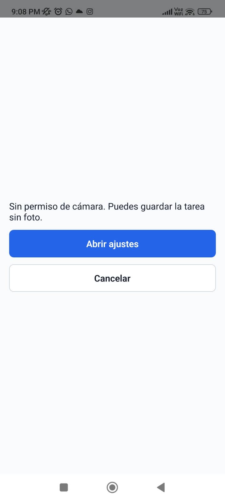
- `EV-24` — CP-MOV-03, RF-11. Método: usuario del equipo, copia WhatsApp `9.10.17 PM (3)`, sin recorte ni reescalado. Fecha: 2026-11-21, 9:09 PM. Dispositivo: Xiaomi 11T Pro (ver `EV-10`), modelo `2107113SG` (ver `EV-25`). Android: 13 (ver `EV-25`). Modalidad: NO VERIFICADO. Commit: `e83c513`. Observado: mismo aviso "Sin permiso de cámara. Puedes guardar la tarea sin foto." con `Abrir ajustes` y `Cancelar`; icono de modo avión visible, sin Wi-Fi ni señal. Equivale a `EV-20` en físico. Pasos (permiso denegado, modo avión, tocar `Tomar foto`): NO VERIFICADO. Revisor: usuario del equipo. Resultado: APROBADO por decisión del usuario (CHK-026).
  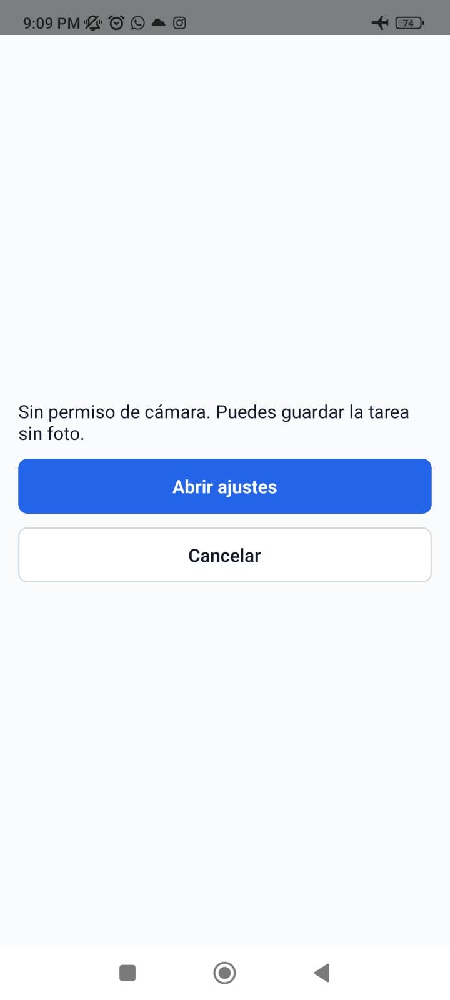
- `EV-25` — Trazabilidad de dispositivo para `EV-18` a `EV-24`. Método: usuario del equipo, captura de la pantalla de información del teléfono, sin recorte ni reescalado. Fecha: 2026-11-21, 9:16 PM (visible en la barra de estado). Dispositivo: Xiaomi, modelo `2107113SG`; RAM 8.0 GB. Android: 13, build `TKQ1.220829.002`; actualización de seguridad 2023-04-01. MIUI: Global 14.0.2 (`14.0.2.0(TKDMIXM)`). Kernel `5.4.147-qgki-ge5a1cc6e50d3`. Observado: pantalla con los datos anteriores. Revisor: usuario del equipo. Resultado: APROBADO por decisión del usuario (CHK-027).
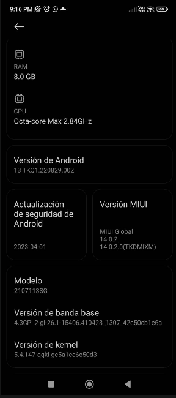
- `EV-26` — CP-MOV-05, RF-12. Método: usuario del equipo, copia WhatsApp `9.23.08 PM (1)`, sin recorte ni reescalado. Fecha: 2026-11-21, 9:21 PM (visible en la barra de estado). Dispositivo: Xiaomi (ver `EV-25`; modelo NO VERIFICADO en la captura). Modalidad: NO VERIFICADO. Commit: NO VERIFICADO. Observado: "Inicio", sesión "QA MOV01", "Sin tareas por ahora.". Estado previo a la tarea. Revisor: usuario del equipo. Resultado: APROBADO por decisión del usuario (CHK-029).
  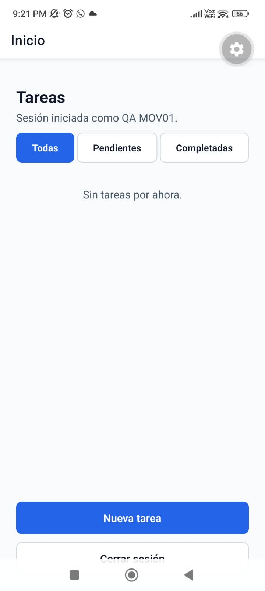
- `EV-27` — CP-MOV-05, RF-12. Método: usuario del equipo, copia WhatsApp `9.23.08 PM`, sin recorte ni reescalado. Fecha: 2026-11-21, 9:22 PM (visible en la barra de estado). Dispositivo: ver `EV-26`. Modalidad: NO VERIFICADO. Commit: NO VERIFICADO. Observado: "Nueva tarea" con título "Prueba GPS" y descripción "GPS denegado", botones `Tomar foto`, `Guardar tarea` y `Cancelar`; sin aviso de ubicación. Paso "denegar ubicación en Ajustes": NO CAPTURADO. Revisor: usuario del equipo. Resultado: APROBADO por decisión del usuario (CHK-029).
  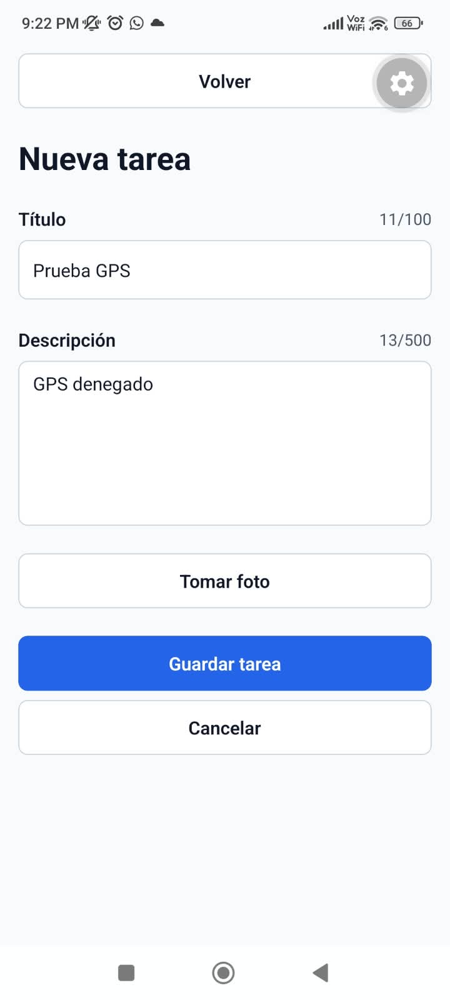
- `EV-28` — CP-MOV-05, RF-12. Método: usuario del equipo, copia WhatsApp `9.23.07 PM`, sin recorte ni reescalado. Fecha: 2026-11-21, 9:22 PM (visible en la barra de estado). Dispositivo: ver `EV-26`. Modalidad: NO VERIFICADO. Commit: NO VERIFICADO. Observado: tarjeta "Prueba GPS", `Pendiente`, `Sin ubicación registrada`, descripción "GPS denegado"; Wi-Fi y señal visibles. Esperado: `Sin ubicación registrada` sin bloqueo. Cumple en tarjeta. Pantalla de detalle (`Ver detalle`): NO CAPTURADA. Permiso de ubicación denegado: NO VERIFICADO en captura. Revisor: usuario del equipo. Resultado: APROBADO por decisión del usuario (CHK-029); CP-MOV-05 sigue `VALIDACIÓN PARCIAL`.
  
- `EV-29` — Contexto de CP-MOV-05, no paso propio. Método: usuario del equipo, copia WhatsApp `9.23.07 PM (1)`, sin recorte ni reescalado. Fecha: 2026-11-21, 9:22 PM (visible en la barra de estado). Dispositivo: ver `EV-26`. Modalidad: NO VERIFICADO. Commit: NO VERIFICADO. Observado: misma tarjeta "Prueba GPS" con `Sin ubicación registrada`; icono de modo avión visible, sin Wi-Fi ni señal. Orden respecto a `EV-28`: NO VERIFICADO (ambas a 9:22 PM). Relación con CP-MOV-06: NO VERIFICADO. Revisor: usuario del equipo. Resultado: NO APLICA como caso de CP-MOV-05.
  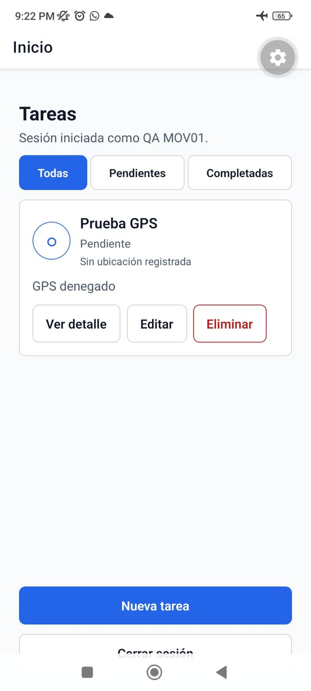
- `EV-30` — CP-MOV-06, RF-13. Método: usuario del equipo, copia WhatsApp `9.28.32 PM (1)`, sin recorte ni reescalado. Fecha: 2026-11-21, 9:27 PM (visible en la barra de estado). Dispositivo: ver `EV-26`. Modalidad: Expo Go con modo avión activo (icono visible). Commit: NO VERIFICADO. Observado: pantalla azul de Expo Go "Something went wrong." con botones de inicio y recargar; la app no abre. Esperado (CP-MOV-06): la app abre con los datos guardados. Causa: NO VERIFICADO ("View error log" no capturado). Revisor: usuario del equipo. Resultado: APROBADO por decisión del usuario (CHK-031). CP-MOV-06 no se reabre: sigue APROBADO con desviación (CHK-016).
  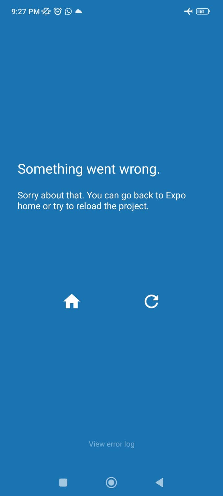
- Formato y trazabilidad: `EV-##` según `AGENTS.md` sección 8.1.
- Ningún caso se marca `APROBADO` por mock o prueba unitaria si el caso exige Android.

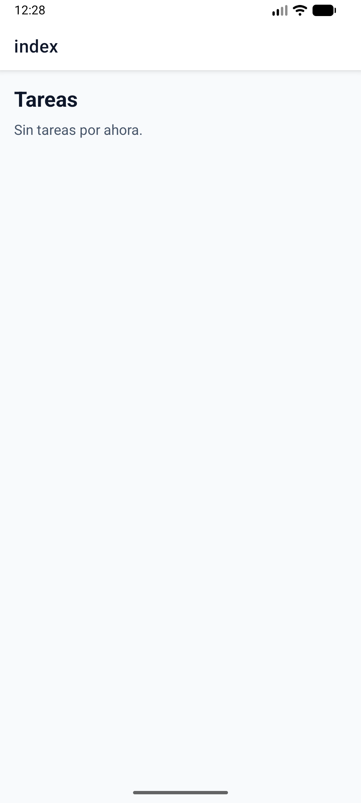
