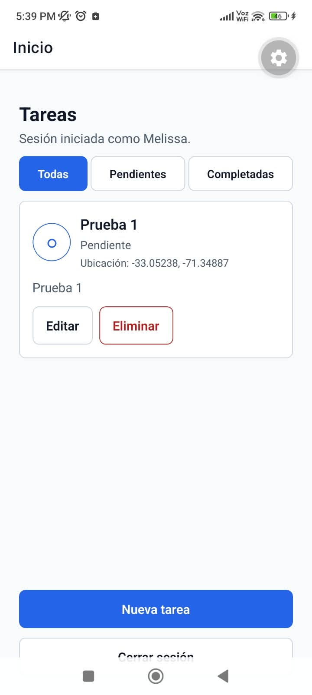
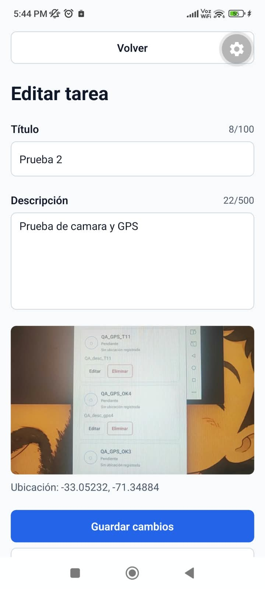
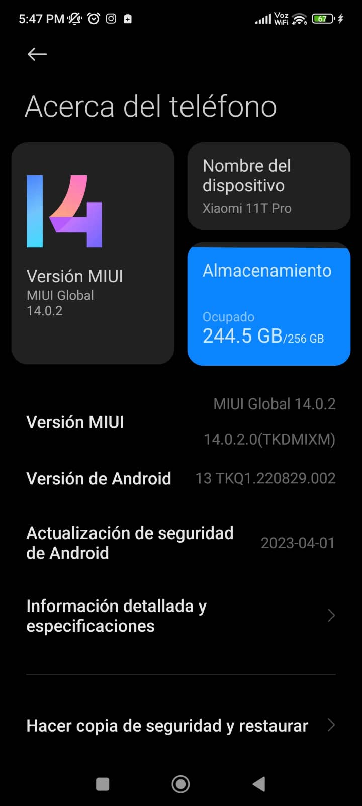

# 03 — Plan de pruebas y gates académicos

> **Estado:** CP-PER-01/02 y CP-GPS-01/02 con pruebas unitarias OK (`npx jest src/features/camera src/features/location`, 2026-11-21). Teléfono Android físico (2026-11-21, Xiaomi 11T Pro, fuente principal de pruebas móviles por limitaciones del emulador): CP-MOV-01 PARCIAL: `EV-14` (registro, 6:29 PM), `EV-15` (sesión iniciada, 6:36 PM) y `EV-16` (pantalla de inicio tras cerrar sesión, 6:37 PM); falta captura de inicio de sesión posterior a `EV-16` que cierre la secuencia (CHK-019). CP-MOV-02 APROBADO con `EV-11` (miniatura visible en detalle, CHK-015); CP-MOV-04 APROBADO con `EV-08` y `EV-09` (CHK-014). Emulador (2026-11-21, CHK-016): CP-MOV-01 OK con `EV-13` (aprobada por el usuario, CHK-020); CP-MOV-06 APROBADO con desviación (persistencia verificada tras reinicio con red; reapertura sin red no alcanzable con Expo Go en desarrollo). Emulador (CHK-009): CP-MOV-03 y CP-MOV-05 OK. CP-MOV-04 en emulador FALLO (el emulador no entrega posición a la app, CHK-012).
> **Referencias:** requisitos en [`docs/01`](./01-REQUISITOS-RUBRICA.md); gates de calidad por tarea en [`AGENTS.md`](../AGENTS.md) sección 8.

## 1. Pruebas automatizadas (Jest + `jest-expo` + RNTL)

Mocks de `expo-camera`, `expo-location` y `expo-sqlite` permitidos solo en pruebas unitarias.

| ID | Unidad | Criterio observable | Requisito |
|---|---|---|---|
| CP-PER-01 | `usePhotoCapture` | Con permiso concedido y cámara que resuelve `{ uri: "file:///x.jpg" }`, devuelve `"file:///x.jpg"`. | RF-11, RUB-03 |
| CP-PER-02 | `usePhotoCapture` | Con permiso denegado, devuelve `null` sin lanzar excepción. | RF-11, RUB-02 |
| CP-GPS-01 | `useCurrentLocation` | Con mock de coordenadas `-33.45, -70.66`, devuelve `{ latitud: -33.45, longitud: -70.66 }`. | RF-12, RUB-03 |
| CP-GPS-02 | `useCurrentLocation` | Con permiso denegado, devuelve `null` sin lanzar excepción. | RF-12, RUB-02 |
| CP-AUTH-01 | `hashClave` | Con el mismo salt y clave `"clave1234"`, devuelve 64 caracteres hex, distintos de la clave, idénticos en dos llamadas. | RF-01, RF-02 |
| CP-AUTH-02 | Registro | Correo existente devuelve `"Ya existe una cuenta con ese correo"`. | RF-01 |
| CP-AUTH-03 | Login | Clave incorrecta devuelve `"Correo o clave incorrectos"`. | RF-02 |
| CP-TAR-01 | Crear tarea | Título vacío devuelve error de validación y no inserta fila. | RF-05, RF-10 |
| CP-TAR-02 | Filtro | Filtro "Completadas" devuelve solo tareas con `completada = 1`. | RF-09 |

Criterio: no escribir pruebas que solo comprueben texto del código, valores por defecto o que la función no lance excepción sin verificar su resultado.

## 2. Pruebas manuales en Android (GA-4)

Requieren emulador o dispositivo Android real con Expo Go (modalidad aprobada, `docs/02` decisión 16). Cada caso con captura antes/después cuando la operación lo exige.

| ID | Pasos | Esperado | Requisito |
|---|---|---|---|
| CP-MOV-01 | Registrar cuenta → cerrar sesión → iniciar sesión con las mismas credenciales. | Acceso a la lista de tareas vacía del usuario. | RF-01 a RF-03 |
| CP-MOV-02 | Crear tarea → tomar foto desde el formulario → guardar → abrir detalle. | Miniatura visible en el detalle. | RF-11 |
| CP-MOV-03 | Denegar permiso de cámara → intentar tomar foto → guardar. | Tarea creada sin foto; mensaje no bloqueante. | RF-11, RUB-02 |
| CP-MOV-04 | Crear tarea con GPS permitido → abrir detalle. | Coordenadas visibles. | RF-12 |
| CP-MOV-05 | Denegar GPS → crear tarea → abrir detalle. | Tarea sin coordenadas; mensaje no bloqueante. | RF-12, RUB-02 |
| CP-MOV-06 | Activar modo avión → crear, editar y completar una tarea → cerrar y reabrir la app. | Cambios persisten. Criterio aprobado 2026-11-21: reapertura verificada con red tras los cambios offline (CHK-016). | RF-13 |

## 3. Gates académicos

| Gate | Criterio | Estado |
|---|---|---|
| G0 — Planificación | Reglas, requisitos y decisiones documentados y aprobados por el usuario. | APROBADO (2026-11-21) |
| G1 — Reproducibilidad | `npm ci`, `npx expo install --check`, `npx jest`, `npx expo start` ejecutados con resultados reales. | PARCIAL: `expo install --check`, typecheck, lint y `jest` 5/5 OK (CHK-003); arranque de `expo start` OK (CHK-004). Falta `npm ci` limpio. |
| G2 — Funciones esenciales | RF-01 a RF-13 implementados y CP-AUTH, CP-TAR, CP-PER, CP-GPS aprobados. | NO EJECUTADO |
| G3 — UX Android | CP-MOV-01 a CP-MOV-06 con evidencia auténtica y revisión humana. | PARCIAL: CP-MOV-01 (`EV-14`, `EV-15`, `EV-16` físico, falta login posterior a `EV-16`; `EV-13` emulador aprobada), CP-MOV-02 (`EV-11`), CP-MOV-03, CP-MOV-04 (`EV-08`, `EV-09`), CP-MOV-05 y CP-MOV-06 (desviación, CHK-016) OK. |
| G4 — Entrega | Checklist de `docs/01` sección 6 completo; PDF o Word con nombre `EVA2_APLICACIONES_MOVILES_LUKAS_COVARRUBIAS_SEBASTIAN_MORALES`. | NO EJECUTADO |

Cierre de entrega: todos los casos en `APROBADO` o en `NO EJECUTADO`/`BLOQUEADO` con motivo escrito.

## 4. Evidencias

- Ruta: `./docs/evidencias/capturas/` desde la raíz (`./evidencias/capturas/` desde `docs/`).
- `EV-01` (agente; emulador `Medium_Phone_API_37.0`; Expo Go; commit `a2e5b8f`): pantalla "Tareas / Sin tareas por ahora.". Revisión humana pendiente.
- `EV-08` — CP-MOV-04, RF-12. Método: agente con captura del usuario. Fecha: 2026-11-21; hora de captura NO VERIFICADA (archivo WhatsApp recibido 5.41.28 PM). Dispositivo: Xiaomi 11T Pro, MIUI Global 14.0.2, Android 13 (TKQ1.220829.002), parche 2023-04-01 (ver `EV-10`). Modalidad: Expo Go (última estable de Play Store, confirmado por el usuario; versión exacta NO VERIFICADA) + Metro local. Commit: `66fd218`. Pasos: crear "Prueba 1" con GPS permitido, guardar, ver tarjeta. Esperado: `Ubicación: lat, lon`. Observado: `Ubicación: -33.05238, -71.34887`. Copia recibida por WhatsApp, sin recorte ni reescalado. Revisor: usuario del equipo (revisión visual 2026-11-21). Resultado: APROBADO.

- `EV-09` — CP-MOV-04, RF-12. Método: agente con captura del usuario. Fecha: 2026-11-21; hora de captura NO VERIFICADA (archivo WhatsApp recibido 5.44.09 PM). Dispositivo: Xiaomi 11T Pro, MIUI Global 14.0.2, Android 13 (ver `EV-10`). Modalidad: Expo Go (última estable de Play Store, confirmado por el usuario; versión exacta NO VERIFICADA) + Metro local. Commit: `66fd218`. Pasos: abrir "Prueba 2" en Editar tarea y ver la línea Ubicación. Esperado: `Ubicación: lat, lon`. Observado: `Ubicación: -33.05232, -71.34884`. Copia recibida por WhatsApp, sin recorte ni reescalado. Revisor: usuario del equipo (revisión visual 2026-11-21). Resultado: APROBADO.

- `EV-10` — Referencia de dispositivo, no prueba funcional. Método: agente con captura del usuario. Fecha: 2026-11-21, 5:47 PM (visible en la captura). Muestra: Xiaomi 11T Pro, MIUI Global 14.0.2, Android 13 (TKQ1.220829.002), parche de seguridad 2023-04-01. Revisor: usuario del equipo. Resultado: NO APLICA (dato de dispositivo).

- `EV-11` — CP-MOV-02, RF-11. Método: agente con captura del usuario. Fecha: 2026-11-21, 6:05 PM (visible en la captura). Dispositivo: Xiaomi 11T Pro, MIUI Global 14.0.2, Android 13 (ver `EV-10`). Modalidad: Expo Go (versión NO VERIFICADA) + Metro LAN (`exp://192.168.1.81:8081`). Código: working tree sobre `2beb98a` con cambios de detalle sin commit (CHK-015). Pasos: abrir "Ver detalle" de una tarea con foto. Esperado: miniatura visible en el detalle. Observado: fotografía visible (no negra), título "Prueba botón 1", `Ubicación: -33.05230, -71.34884`. Copia recibida por WhatsApp, sin recorte ni reescalado. Revisor: usuario del equipo. Resultado: APROBADO.

- `EV-12` — soporte de navegación para CP-MOV-02 (no es caso propio). Método: agente con captura del usuario. Fecha: 2026-11-21, 6:05 PM (visible en la captura). Dispositivo: ver `EV-11`. Observado: lista con botón "Ver detalle" en "Prueba botón 1" y "Prueba 2". Revisor: usuario del equipo. Resultado: NO APLICA como caso; respalda `EV-11`.

- Formato y trazabilidad: `EV-##` según `AGENTS.md` sección 8.1.
- Ningún caso se marca `APROBADO` por mock o prueba unitaria si el caso exige Android.

